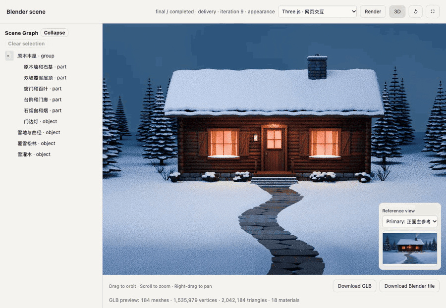

# UniBlenderScene

English | [简体中文](README.zh-CN.md)

A Blender scene creation and review plugin for **Codex** and **Claude Code**.

Turn reference images or text into editable Blender scenes. Combine your agent
harness with 3D APIs such as [Tripo](https://developers.tripo3d.ai/en/docs/introduction)
or [Meshy](https://docs.meshy.ai/en/api) to generate individual objects, then
assemble and refine the scene in Blender.

Deliver renders, `.blend` files and GLBs, with interactive 3D preview in
compatible MCP Apps hosts. Completed scenes can also be prepared for rendering
and interactive presentation with [Meshy's ThreeRT](https://github.com/meshy-dev/ThreeRT).

| Host | How to use it |
| --- | --- |
| Codex | Install the plugin; review renders and open interactive previews in an MCP Apps host |
| Claude Code | Load the plugin; inspect renders and access `.blend`/GLB files from the terminal |
| Other agent harnesses | Connect to the MCP service and load the scene workflow instructions; preview support depends on the host |

## Showcase: winter cabin at blue hour

A single reference image guided this scene in Blender. After confirming the
gray-model composition, the scene received textures, cool exterior lighting,
warm windows and a chimney plume. Below are the reference, Blender render and
ThreeRT render.

<table>
  <tr>
    <th width="33%">Reference</th>
    <th width="33%">Blender render</th>
    <th width="33%">ThreeRT render</th>
  </tr>
  <tr>
    <td align="center" valign="top"></td>
    <td align="center" valign="top"></td>
    <td align="center" valign="top"></td>
  </tr>
</table>

This stylized reconstruction was modeled locally in Blender. Some vegetation
and path details are simplified; sky brightness, window color and smoke differ
between the two renderers.



Select a Scene Graph node to focus its object and show its bounds and XYZ axes.
The Three.js preview keeps the selection aligned as you orbit the scene.

## What's in the plugin


Shared Skills guide planning and visual review, a dedicated Blender service
builds and renders the scene, and the viewer supports interactive inspection.
Codex and Claude Code use the same scene workflow.

Standalone objects use an applicable, separately configured 3D asset provider;
connect Tripo, Meshy or another provider through your agent harness's tools or
Skills. The agent imports the generated assets into Blender for placement and
scene review. Room surfaces and simple primitives can be procedural. If no
applicable provider is available, the workflow can fall back to Blender modeling.
Provider access, API keys and generation costs are configured separately. See the
[asset workflow](skills/blender-scene/references/assets.md).

## Quick start

Follow these four steps for a first local scene in Codex on macOS or Linux.
Before starting, install Git, Node.js 22+, Blender 4.5+, and Codex with the
`codex` CLI available. Sign in to Codex. The launcher also requires `lsof` and `ps`.

1. **Download the plugin and prepare it.** Run in a terminal:

   ```bash
   git clone https://github.com/creativedswork/UniBlenderScene.git
   cd UniBlenderScene
   npm ci
   npm run build
   pwd
   ```

   The directory printed by `pwd` is your **plugin source directory**: the
   repository root containing `plugin.json`, `mcp.json`, `skills/`, and
   `.agents/plugins/marketplace.json`. Use this root when adding the source.

2. **Start Blender and the MCP service together.** In the same terminal, from
   that repository root, run:

   ```bash
   node --import tsx scripts/start-local.ts
   ```

   On macOS, the launcher uses `/Applications/Blender.app/Contents/MacOS/Blender`;
   on Linux, it uses `blender` from `PATH`. For a different installation, run
   `BLENDER_BIN="/absolute/path/to/blender" node --import tsx scripts/start-local.ts`.
   Continue when it prints `Ready: http://127.0.0.1:4312/mcp (...)`.
   Both processes stay running after the launcher exits.

3. **Install the plugin in Codex.** Still in the repository root, register the
   local source:

   ```bash
   codex plugin marketplace add "$PWD"
   ```

   In Codex's Plugins Directory, find the **UniBlenderScene** source and install
   **UniBlenderScene**. The source name shown there refers to the repository
   directory registered above.

4. **Create your first scene.** Create a separate project directory:

   ```bash
   mkdir -p ../UniBlenderScenes
   ```

   Open that directory as a project in Codex and start a new chat to load the
   installed plugin. Send:

   > Use UniBlenderScene to create a simple room with a floor, two walls, a cube
   > pedestal and a sphere on top. Use procedural primitives and warm lighting.
   > Pause for my composition approval, then deliver a render, an editable
   > .blend file and a GLB. Open the interactive preview if this host supports it.

   When the agent shows the gray composition, review it and reply
   **Approve composition; continue with materials and lighting**, or describe
   the changes you want. After refinement, the agent provides the render and
   scene files. Interactive preview requires an MCP Apps host.

### Individual setup operations

For later runs, or to customize a step:

| Task | How |
| --- | --- |
| Start the local service again | Run `node --import tsx scripts/start-local.ts` from the plugin source directory. It reuses its own running processes. See [launcher behavior and logs](docs/operations.md#start-the-local-processes-together). |
| Start Blender and the MCP service separately | Follow [manual service startup](docs/operations.md#run-the-local-service) for the Blender bridge command and `npm start`. |
| Use Claude Code | Follow [Claude Code setup](docs/operations.md#claude-code) to load the same plugin from a separate scene project. |
| Generate objects with Tripo or Meshy | Connect the provider's tools or Skill to your agent harness, configure its API access, then ask the agent to use it for scene assets. See the [asset workflow](skills/blender-scene/references/assets.md). |
| Present the result with ThreeRT | Install the native client and configure `THREERT_BIN`, then ask the agent to render or open the completed scene with ThreeRT. See [ThreeRT preview](#threert-preview). |
| Use reference images | Attach up to 6 images and identify the primary view. For local file access, configure `LOCAL_REFERENCE_ROOTS` as described in [configuration and access](docs/operations.md#configuration-and-access). |
| Connect to a remote service | Follow [remote service setup](docs/operations.md#connect-a-remote-service). |

## Scene workflow

The [scene Skill](skills/blender-scene/SKILL.md) guides a staged process:

1. **Plan:** identify the main objects, spatial relationships and visual goals.
2. **Build:** establish the full scene, then refine geometry and composition.
3. **Confirm:** review the gray scene from multiple views and approve composition
   before materials and lighting begin.
4. **Refine:** add materials and lighting, rendering and checking each iteration.
5. **Deliver:** export the best reviewed checkpoint as a render, `.blend` and GLB.

The agent supplies planning and visual judgment; the service executes Blender
operations, saves checkpoints and tracks review progress. See the
[workflow design](docs/scene-generation-preview.md) for details.

## Memory: learning across scene tasks

The workflow pairs an inner **edit → render → review → revise** loop with an
outer loop that captures lessons from completed scenes. Verified repairs can
become reusable guidance, Blender functions or checks after validation, and
later tasks can retrieve applicable entries.

Memory stays in the service's local data directory and survives restarts.
Learning runs during agent tasks; it does not change model weights. See the
[experience workflow](skills/blender-scene/references/experience.md).

## Interactive 3D preview

Ask the agent to open the preview in a host that supports MCP Apps. You can:

- Orbit, zoom, pan and reset the camera.
- Click the Three.js or ThreeRT view: W/S moves along the viewing direction, including up or down when tilted; A/D moves sideways. Hold Shift to move faster.
- Select objects in the scene tree or 3D view to inspect their bounds.
- Switch between the Blender render and interactive 3D preview.
- Review neutral gray views, then approve composition or request changes in chat.

Use the gray views to check proportions and placement, and the Blender render
to review lighting and materials.

### ThreeRT preview

Explore your completed scene in ThreeRT to inspect its lighting, materials and
spatial depth from different viewpoints. When ThreeRT is available, completed
scenes open in this mode automatically.

Use the preview selector to switch to **Three.js · 网页交互** for quick
navigation and layout checks. Select **Render** to compare with the Blender
image. Appearance can differ between preview modes; use the Blender render
when reviewing the final look.

For static scenes, ask the agent to optimize the browser preview for smoother
navigation. If ThreeRT is unavailable, you can explore the scene with Three.js.
See [preview setup](docs/operations.md#threert-setup-and-limits) to enable ThreeRT.

## Related research

- [VIGA: Vision-as-Inverse-Graphics Agent via Interleaved Multimodal Reasoning](https://arxiv.org/abs/2601.11109)
  (Yin et al., 2026) describes a code, render, inspect, and revise loop for
  reconstructing editable scenes from images. Its visual feedback approach is
  relevant to this plugin's scene review workflow.
- [SceneCraft: An LLM Agent for Synthesizing 3D Scene as Blender Code](https://arxiv.org/abs/2403.01248)
  (Hu et al., 2024) uses scene planning, Blender Python generation, and rendered
  visual feedback to refine 3D scenes.

## Documentation

- [Service setup and deployment](docs/operations.md): local runtime, plugin
  source, remote connection, configuration, and packaging.
- [Scene Skill](skills/blender-scene/SKILL.md): scene workflow and tool use.
- [Validation results](docs/validation.md): checks performed for this release.

## Credits and upstream updates

The plugin includes [Scenario Blender Skills](skills/scenario-blender-expert/SKILL.md),
credited to Scenario Labs and its contributors under the
[MIT license](skills/scenario/LICENSE). See [upstream tracking](docs/scenario-skills.md)
for the pinned revision and update process.
