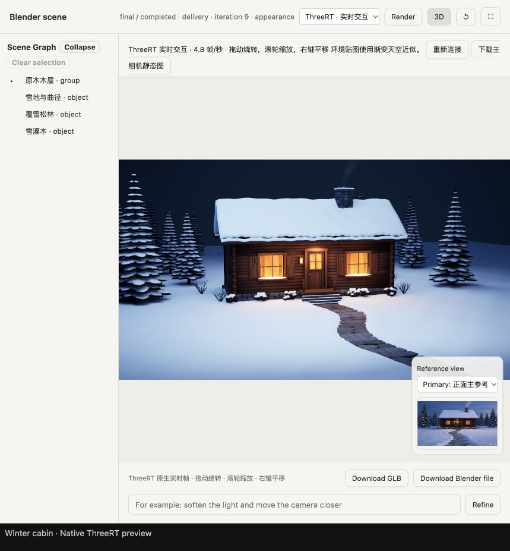

# UniBlenderScene

A Blender scene creation and review plugin for agent harnesses, with native
plugin entries for **Codex** and **Claude Code**.

Turn reference images or text into editable Blender scenes. Both plugins share
the same Skills, staged workflow and MCP service: plan the scene, build geometry,
confirm composition in gray, then refine materials and lighting. Deliver renders,
`.blend` files and GLBs, with native ThreeRT preview in compatible MCP Apps hosts.
Three.js remains available for structural review and browser-only inspection.

| Host | Integration | Visual review |
| --- | --- | --- |
| Codex | Portable plugin manifest and shared Skills | Renders and artifact links; interactive preview in an MCP Apps host |
| Claude Code | Native plugin manifest and shared Skills | Render inspection and `.blend`/GLB links in the terminal |
| Other agent harnesses | Connect to the MCP service and supply the scene workflow instructions | Depends on the host's image and MCP Apps support |

The host supplies the model, planning, code generation and visual judgment. The
service executes scene operations through a dedicated Blender process and enforces
scene state, checkpoints, stage budgets and approval. Additional harnesses need
their own MCP connection and instruction loading; native plugin packaging is
provided for Codex and Claude Code. The embedded viewer requires MCP Apps;
the Three.js backend requires WebGL 2. ThreeRT runs on the service host.

## Showcase: winter cabin at blue hour

A single reference image guided this scene in Blender 5.1.1. After gray-model
composition approval, the scene received packed PBR textures, cool exterior
lighting, warm windows and a localized chimney plume. The images show the
exported iteration 9 checkpoint, rendered in Blender and ThreeRT.

<table>
  <tr>
    <th width="33%">Reference</th>
    <th width="33%">Blender render</th>
    <th width="33%">ThreeRT render</th>
  </tr>
  <tr>
    <td align="center" valign="top"></td>
    <td align="center" valign="top"></td>
    <td align="center" valign="top"></td>
  </tr>
</table>

The user authorized this reference for the README showcase and explicitly chose
local Blender modeling for this example. The reconstruction is stylized: fir
branches and shrubs are simpler, and the path is narrower than the reference.
ThreeRT uses its own display transform and a gradient approximation of the
exported environment, so sky brightness, window color and smoke differ from
Blender. Editable scenes and runtime data stay outside Git.



The screenshot shows the bundled MCP Apps viewer connected to the native
ThreeRT client through a local validation host. Default connection, camera
orbit and reset, and Render/3D switching were checked on this scene. The viewer
reports the delivered frame rate; the local validation host is not a packaged
standalone preview server.

## What's in the plugin

The five modules are grouped by responsibility:


| Part | What it does | Main files |
| --- | --- | --- |
| Plugin metadata | Portable Codex entry and native Claude Code entry, sharing Skills and the service. | [`plugin.json`](plugin.json), [`mcp.json`](mcp.json), [`.claude-plugin/plugin.json`](.claude-plugin/plugin.json), [`harnesses/claude-code/mcp.json`](harnesses/claude-code/mcp.json) |
| Skills | Explain setup and guide scene planning, editing, visual review, required single-object Provider discovery, and bundled Blender production techniques. | [`skills/blender-setup/`](skills/blender-setup/SKILL.md), [`skills/blender-scene/`](skills/blender-scene/SKILL.md), [`skills/scenario-blender-*/`](skills/scenario-blender-expert/SKILL.md) |
| MCP service | Exposes scene tools, tracks jobs and review state, saves checkpoints, and provides artifact URLs. | [`src/service/server.ts`](src/service/server.ts), [`src/service/store.ts`](src/service/store.ts) |
| Blender bridge | Executes scene code in a dedicated Blender process, then renders and exports the result. | [`runtime/blender/bridge.py`](runtime/blender/bridge.py), [`runtime/blender/export.py`](runtime/blender/export.py) |
| Preview viewer | Shows Blender renders, native ThreeRT interaction, and Three.js structural review with scene-tree selection inside an MCP Apps host. | [`src/viewer/widget.ts`](src/viewer/widget.ts), [`src/viewer/widget.html`](src/viewer/widget.html) |

Standalone objects must use an applicable separately configured 3D API Provider.
The host checks both connected tools and available Skills, including Providers
accessed through a Skill's CLI. Blender fallback requires discovery evidence for
both inventories; the service cannot inspect the host's catalog itself.
Geometry plans record each object strategy and its downloaded GLB provenance;
room surfaces and simple primitives can be procedural.
The plugin does not bundle a 3D asset provider or its credentials.

## Quick start

1. In Codex, install **UniBlenderScene** from the **UniBlenderScene** plugin source.
   In Claude Code, start from a separate scene project outside the plugin checkout
   and pass `--plugin-dir /absolute/path/to/UniBlenderScene`, then invoke
   `/uni-blender-scene:blender-setup` or `/uni-blender-scene:blender-scene`.
   See [client installation](docs/operations.md#install-the-plugin-source).
2. Start the [Blender MCP service](docs/operations.md#run-the-local-service), or
   [connect to a deployed service](docs/operations.md#connect-a-remote-service).
   The bundled connection points to `127.0.0.1`; installing the plugin does not
   start Blender or the service. To start both local processes together, use
   [the local launcher](docs/operations.md#start-the-local-processes-together).
3. Attach an image or describe a scene, then ask for a render and interactive 3D
   preview. For example:

> Create a Blender scene matching this image. Preserve the camera composition,
> lighting and main objects, then show the interactive 3D result.

To use Claude Code, run
`claude --plugin-dir /absolute/path/to/UniBlenderScene`
from the scene project. Sign in through Claude Code and use its configured model,
or select one with `--model sonnet`. See the official
[CLI reference](https://code.claude.com/docs/en/cli-reference),
[scene project setup](docs/operations.md#claude-code) and
[CLI validation](docs/operations.md#validate-claude-code).

## Repository layout

```text
plugin.json, mcp.json       Portable plugin entry for Codex
.agents/plugins/           Codex marketplace
.claude-plugin/            Claude Code manifest and marketplace
skills/                    Shared scene workflow and production knowledge
harnesses/                 Client-specific MCP configuration and agent templates
src/service/               MCP tools, scene state, workflow checks, Blender client
src/viewer/                MCP Apps viewer with ThreeRT and Three.js previews
runtime/blender/           Dedicated Python bridge and export code
scripts/                   Build, configure, package, upstream checks
tests/                     Workflow, Blender, viewer, and harness validation
docs/                      Setup, design, showcases, validation records
.canova/runs/              Ignored local scenes and validation evidence
```

The project identity is **UniBlenderScene** (`uni-blender-scene`, version 0.3.3).
The canonical repository is
[`creativedswork/UniBlenderScene`](https://github.com/creativedswork/UniBlenderScene).
Existing run directories and Blender `codex_bake_lighting` /
`codex_preview_emissive_tint` properties retain their names for saved-scene compatibility.

## Scene workflow

The [scene Skill](skills/blender-scene/SKILL.md) describes this tool sequence:

| Tool | Result |
| --- | --- |
| `scene_create` | Create a scene with an optional reference image |
| `scene_plan` | Set criteria, required Scene Graph and assets, and stage budgets |
| `scene_plan_review` | Verify graph coverage and spatial relationships against every view |
| `scene_asset_strategy` | Record Provider discovery and local GLB, or no-Provider Blender fallback |
| `scene_graph` | Update graph names and completion states during editing |
| `scene_edit` | Run Blender code, save and render |
| `scene_get` | Inspect the scene and latest render |
| `scene_review` | Review the render and select the best checkpoint |
| `scene_review_decision` | Approve or revise the geometry and composition checkpoint |
| `scene_review_views` | Retry generation of the five confirmation views |
| `scene_preview` | Prepare current geometry/composition work or a pending checkpoint as a gray 3D preview without approving it |
| `scene_export` | Export the best reviewed `.blend` and GLB after completion |
| `scene_view` | Open the interactive viewer after the current-stage render is ready |
| `scene_render_high_quality` | Prepare the native ThreeRT delivery scene and render its main camera without spending an edit |
| `scene_continue` | Refine an existing scene |

The service saves a checkpoint before each edit, supplies an iteration-bound inspection, and exports the best reviewed scene. See the [0.2.0 acceptance checklist](docs/acceptance-0.2.0.md) for Provider, multi-view and approval checks.
For full reconstructions, the plan runs ordered geometry, composition,
materials, lighting, and final stages with one budget per stage. Composition
approval is mandatory before materials; five neutral Blender views are
available in the widget. The explicit decision tool resumes from the saved
checkpoint or returns to geometry or composition with feedback.

An image-based request must pass its image through `scene_create.reference`; the
service rejects a text-only create when the request refers to an image. The
scene Skill directs the first edit to build a complete scene blockout, then later edits refine bounded
parts. The scene Skill supplies the same pinned Scenario Blender production
knowledge revision as Canova, adapted to this plugin's host-driven tools.
For reference images, the host records major regions in normalized image
coordinates and measures them in each render. The service checks those submitted
measurements and keeps composition open when a region edge differs by more than
8% of the frame; it does not detect objects in images on its own.

## Memory: learning across scene tasks

Memory is a persistent local library of scene cases, lessons and validated
reusable skills. It supplements the inner scene loop (edit, render, review,
revise) with an outer loop that turns supported repairs into production
functions, checks or guidance for later tasks. The host supplies the reasoning;
the service stores evidence, runs validation and controls which versions can be
retrieved. See the [experience workflow](skills/blender-scene/references/experience.md)
and [library implementation](src/service/experience.ts).

| Stored memory | Contents and purpose |
| --- | --- |
| Scene case | Delivery checkpoint hashes, export version, review history and remaining gaps |
| Retrospective | Problem, cause, repair, verification, applicability and limitations; user-accepted differences remain separate |
| Skill candidate | An immutable version of `guidance`, a `blender_function` or a `check`, linked to verified source lessons |
| Validation and active version | Case reviews, fixture results and the exact version available for reuse; earlier versions remain available for rollback |

The host follows the [scene Skill](skills/blender-scene/SKILL.md) and the service's
`blender-scene` MCP Prompt to perform this cycle during normal task execution:

1. **Retrieve:** scene responses list relevant active skills in `learning.skills`.
   The host reads their full instructions/code with `scene_library_search` before
   planning and applies suitable functions through the guarded `scene_edit` path.
2. **Capture:** final export records a case automatically. Successful edit scripts
   stay under the scene's `scripts/` directory for later inspection.
3. **Reflect:** after checking the delivery, the host sees
   `learning.retrospectiveDue: true` and calls `scene_experience` before its final
   reply. The retrospective binds the current case fingerprint and copies the
   selected evidence into hash-addressed storage. Recording it clears the flag.
4. **Consolidate:** `learning.batchDue` becomes true when unused verified lessons
   exist from at least three distinct scenes. The host groups recurring lessons
   into skill candidates; an important reproducible repair can be proposed sooner.
   Observations and preferences remain cases and cannot become shared skills.
5. **Validate and activate:** the host reviews applicable cases and counterexamples,
   runs the candidate's checks, then activates its latest passing exact version.
   A new proposal leaves the previous active version in place until activation.

For example, the following fields in a `scene_get` response tell the host that
the current delivery needs a retrospective, while batch consolidation is not due:

```json
{
  "learning": {
    "retrospectiveDue": true,
    "batchDue": false,
    "case": { "fingerprint": "<current case fingerprint>" },
    "skills": []
  }
}
```

With the updated Skill or MCP Prompt loaded, the host performs these memory
steps without separate user reminders or per-entry confirmations. The flags are
structured task signals, not UI notifications or a server-enforced delivery
block. A host that ignores them can still deliver without a retrospective.
Learning runs while the host is executing a task; the service does not run a
background model or change model weights. Existing composition and paid-Provider
authorization requirements still apply.

| Tool | Result |
| --- | --- |
| `scene_experience` | Prepare a case or record a fingerprint-bound retrospective with immutable evidence and accepted differences |
| `scene_library_search` | Retrieve active skills and cases; optionally inspect candidates and validation reports |
| `scene_skill_propose` | Version reusable guidance, Blender production functions or checks derived from verified lessons |
| `scene_skill_validate` | Review source cases and run positive/counterexample unittest fixtures through the dedicated Blender queue |
| `scene_skill_activate` | Activate the latest passing exact version, retire it, or reactivate a previously verified version |

Guidance is labelled `host-review` and requires applicable/counterexample cases
from distinct scenes. Executable entries are labelled `blender-tests`; empty,
skipped and failing suites cannot qualify. Tests use disposable scenes and
restore the task checkpoint without consuming scene edit rounds. Learned code
has the same OS permissions as `scene_edit`; this is not a sandbox. Applying
functions to a production scene still uses `scene_edit` and its workflow guards.
Fixture success does not establish visual similarity to a new reference.

The library is shared by scenes using the same `RUNS_ROOT`, and survives service
restarts and new host conversations. Metadata lives in
`RUNS_ROOT/experience-library/library.json`; copied evidence lives in its
`evidence/` directory. The default root is `.canova/runs/`. Separate roots have
separate libraries; moving the service requires retaining this data to retain
its memory. Retrieval uses task terms matched against titles, tags and
applicability; it does not require an embedding service.

Missing or changed source evidence excludes a skill from retrieval. Failed
validation prevents activation, and `scene_skill_activate` can retire an entry
or reactivate a previously verified version. Learning does not rewrite installed
Skills, edit repository source or publish a plugin. Runtime cases and user images
are excluded from Git and plugin packages; memory remains local to the service's
data root.

## Authoritative workflow state

Every scene response includes `workflowState`. `phase` identifies the production
stage; `status` identifies the operation state, such as `edit`, `review` or
`awaiting_review`. `presentation` fixes the image mode, purpose, source and
iteration. It is derived from the scene's persisted plan, workflow index and
status; there is no second independently writable phase variable. Each scene
has its own state, including after a service restart or a new agent conversation.

| Production/state | Presentation | Source and purpose |
| --- | --- | --- |
| Geometry or composition, editing/reviewing | Gray main image; current five-view/GLB preview on request | Current working iteration; work draft |
| Awaiting composition approval | Gray main image, five views and GLB | Preserved checkpoint; confirmation |
| Materials, lighting or final work | Appearance render | Current working iteration; work draft |
| Completed or best-effort delivery | Reviewed appearance | Selected best checkpoint; delivery |

Geometry/composition edits automatically render gray images. `scene_review_views`
and `scene_preview` can inspect incomplete work without advancing its phase,
spending an edit round or approving it. Views, profiles and manifests identify
their source and iteration; stale or wrong-mode artifacts are not offered as
the current result. Work drafts never expose an approval button. Final export
and explicit composition approval retain their existing state checks.

## Interactive 3D preview

During geometry/composition work or at its confirmation checkpoint, call
`scene_preview` with the scene ID, then poll `scene_get` with `images: "none"`
until the job finishes. Open `scene_view` only when the snapshot's `renderUrl`
is non-null. Creation and progress queries return data without opening a card.
The service generates missing five-view evidence and chooses the source from
`workflowState`: current work during editing/review, preserved best checkpoint
while `awaiting_review`. The viewer loads that iteration's GLB, render profile
and Scene Graph. Preparing this preview
preserves the checkpoint, pending approval, and stage budget. Final
`scene_export` remains blocked until the workflow reaches `completed` or
`best_effort`; only `scene_review_decision` records the user's decision.

During structural confirmation, the main image and five review views use neutral
gray shading. The review GLB replaces textures and material effects with opaque
gray surfaces and neutral studio lighting on an export copy. Original materials,
lights and `.blend` checkpoints are retained for downstream work and final export.
Previously cached textured review GLBs are hidden until `scene_preview` regenerates
them. Original `.blend` files keep their materials; work drafts expose previews,
while checkpoint/final downloads may include the original `.blend`.

The Scene Graph uses stable `scene_node_id` properties on Blender objects.
Export includes `scene-graph.json` and `manifest.json`, and checks that built
objects map to GLB meshes. Organizational groups can use their descendants'
meshes. The viewer supports:

- Select a tree node to frame the object or group and show its orange 3D bounds
  with red X, green Y, and blue Z direction arrows.
- Click a mesh to select its tree entry while preserving the camera view.
- Orbit, zoom, pan, and reset the camera. Bounds stay aligned with the selection.
- Click empty space, press Escape, or use **Clear selection** to deselect.
- Switch between the Blender render and 3D preview; review the five neutral views
  before approving or requesting changes to composition.

The arrows show world-axis directions and do not edit transforms. Scene Graph
bounds and axis overlays use Three.js and require WebGL 2. Blender renders remain
the visual review source. Both preview backends use an MCP Apps host;
the MCP endpoint itself is not a Chrome preview page. See the
[viewer checklist](docs/acceptance-0.2.1.md) and
[service setup](docs/operations.md#open-the-interactive-preview).

### ThreeRT preview

The viewer defaults to **ThreeRT · 实时交互** for a completed, exported scene
when the service has a native client configured. It prepares the native scene
if needed, then connects the browser's orbit, zoom and pan controls to the native
renderer. Choosing another backend is preserved while the scene refreshes.
**Render** shows the Blender image; **3D** returns to the selected backend.
Reset restores the saved main camera. A separate download provides the native
main-camera static render.

ThreeRT runs on the service host. The preview transport reads PNG frames
from the native client; it is not a browser GPU renderer or a video stream.
The winter-cabin check delivered roughly 4–5 frames/second through this path;
readback adds input latency. The viewer displays the actual delivered frame rate. Use
**Three.js · 网页交互** when smooth local interaction is required. Only one
native viewport can be controlled at a time; connecting another viewer replaces
the previous session. Native client credentials remain on the service host.

Install the [ThreeRT native client](https://threert.dev/download/) or build
`threert-render` from [its source](https://github.com/meshy-dev/ThreeRT), then set
`THREERT_BIN` in the service environment and restart the service:

```dotenv
THREERT_BIN=/Applications/ThreeRT.app/Contents/MacOS/threert
```

Live interaction requires the native `threert` CLI; the standalone
`threert-render` executable supports static rendering only. The executable may
also be found on `PATH`. No native engine is bundled or downloaded automatically.
The menu disables native interaction when the client is unavailable, and a
failed connection restores the browser preview. The local launcher reads `.env`
when starting the service. A delivered, exported scene is required; structural
review and composition approval continue to use Blender evidence and Three.js.
Selecting a Scene Graph object opens Three.js for its bounds and axis overlay.

`scene_render_high_quality` exports unbaked source PBR materials on a Blender
copy, then calls the native engine. This avoids treating baked lightmaps as
physical emitters. It preserves the approved scene, original GLB and edit budget.
Poll `scene_get` with `images: "none"`; the current successful image is exposed as
`threert.png`. Output, input settings and engine logs remain under the scene's
`threert/` directory in `.canova/runs/`. Older exports' images are not presented
as current, and a failed render can be retried without rebuilding the scene.

The adapter imports perspective cameras, source lights, PBR materials,
environment lighting and local fog volumes. The native engine currently rejects
HDRI environments, so the adapter fits a zenith/horizon/ground gradient from the
exported EXR and approximates a separate camera background by its horizon color;
the viewer labels this difference. Disk area lights are approximated
by rectangles; ThreeRT uses its own filmic display transform. Local dust uses
animated world-space density noise and the exported wind, lit and occluded by
the native engine. Its live volume lighting differs from both the offline path
tracer and the browser's single-scattering preview. Orthographic cameras are
currently unsupported. Image quality and native
GPU support must be verified for each scene; the option makes no photorealism
guarantee.

## Multiple reference views

Supply up to 6 images of the same scene in `scene_create.references`. The first
image defines the primary camera and composition; auxiliary images clarify
depth, occlusion, and relative object positions. Each file can include a short
`label`, such as "right side". The original single-image `reference` input is
still supported. Use `scene_continue.references` to append views to a delivered
scene while preserving its primary image, with at most 6 references in total.

Select image content explicitly when using `scene_get`:

| `images` | Returned image content |
| --- | --- |
| `render` | Latest render only; use once after each edit |
| `references` | Reference views only; inspect once before planning |
| `none` | No images; scene state and reference metadata remain available |
| `all` | References and latest render; also the legacy behavior when omitted |

`referenceName` selects one reference view, alone or with `images: "references"`.
`objectName` returns object data without images, alone or with `images: "none"`.
Do not combine these selectors with incompatible image modes. Poll with
`scene_get` with `images: "none"`, then retrieve each finished render once with `images: "render"`.
Avoid reading that same PNG again through the host's image-reading tool.

Image limits apply to the conversation sent to the model, including repeated
tool results. The shared Skill asks the host to count images from all sources,
respect the active model's image limit and reserve room for the next review.
When that limit is unknown, around 35 images is a conservative workflow
checkpoint, not a Claude Code limit or a server-enforced quota. The service cannot
remove historical images from Claude Code; see
[image-history recovery](docs/operations.md#image-history-and-recovery).

The embedded viewer lets users select and enlarge any reference. In clients
that expose file upload, select multiple images, choose the primary view, then
create a scene or add views to the current scene. The host model reconciles the
views during planning and spatial review; image-space alignment uses the primary
view. This input support does not automatically estimate calibrated cameras or
triangulate geometry.

In local Codex or Claude Code, attach the images to the conversation and ask to use the Blender
scene plugin. Each reference can use `local_path` instead of `download_url` and
`file_id`. The local service must enable the image directories with
`LOCAL_REFERENCE_ROOTS` (platform path separator). Local files are disabled by
default; approved files are copied into the scene and checked for PNG/JPEG/WebP
content and the 20 MB limit. Reinstall an updated local plugin, then restart
the host and use a new conversation to load its tools and instructions.

## Related research

- [VIGA: Vision-as-Inverse-Graphics Agent via Interleaved Multimodal Reasoning](https://arxiv.org/abs/2601.11109)
  (Yin et al., 2026) describes a code, render, inspect, and revise loop for
  reconstructing editable scenes from images. Its visual feedback approach is
  relevant to this plugin's scene review workflow.
- [SceneCraft: An LLM Agent for Synthesizing 3D Scene as Blender Code](https://arxiv.org/abs/2403.01248)
  (Hu et al., 2024) uses scene planning, Blender Python generation, and rendered
  visual feedback to refine 3D scenes.

## Documentation

- [Service setup and deployment](docs/operations.md): local runtime, plugin
  source, remote connection, configuration, and packaging.
- [Scene Skill](skills/blender-scene/SKILL.md): scene workflow and tool use.
- [Validation results](docs/validation.md): checks performed for this release.

## Credits and upstream updates

The [scene Skill](skills/blender-scene/SKILL.md) is installed alongside the
[Scenario Blender Skills](skills/scenario-blender-expert/SKILL.md). Each domain
has a directly loadable `SKILL.md` and retains its pinned upstream source as
`UPSTREAM.md`. The original files and [MIT license](skills/scenario/LICENSE)
are credited to Scenario Labs and its contributors. Scene edits still run only
through this plugin's dedicated bridge. See [upstream tracking](docs/scenario-skills.md)
for the pinned revision and `npm run check:scenario-skills` update check.
