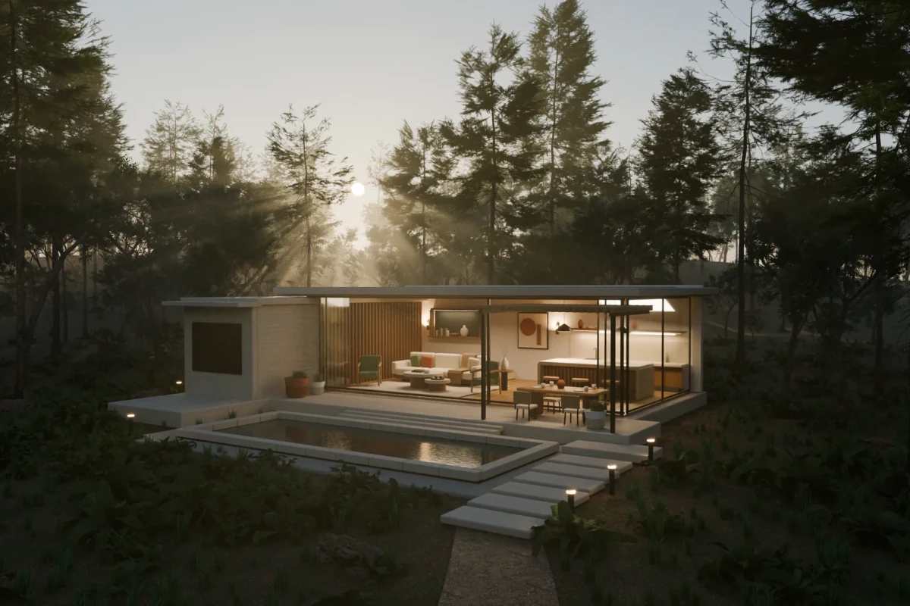
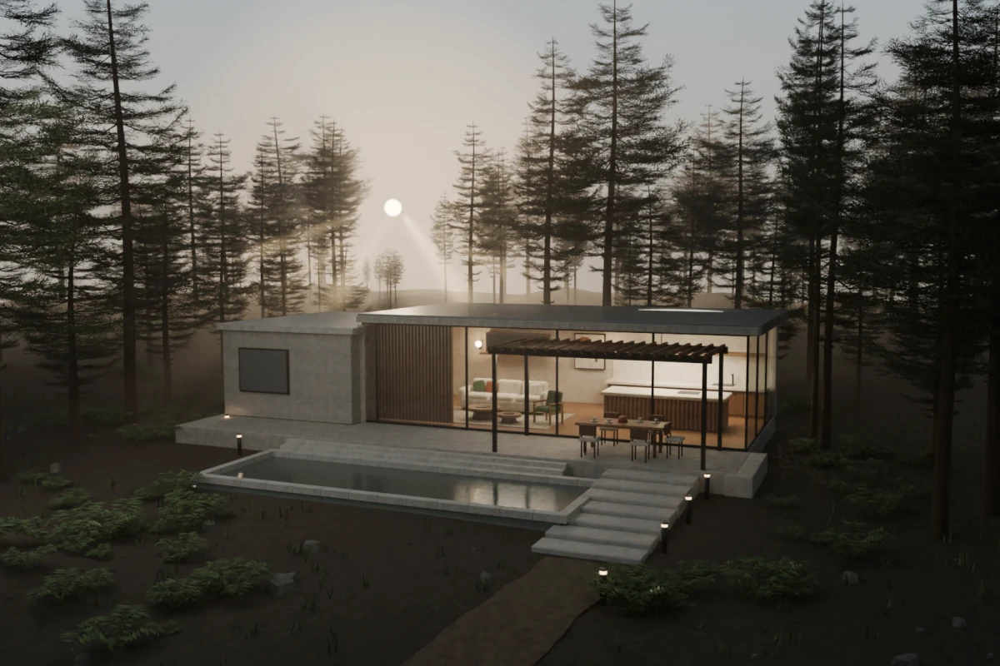
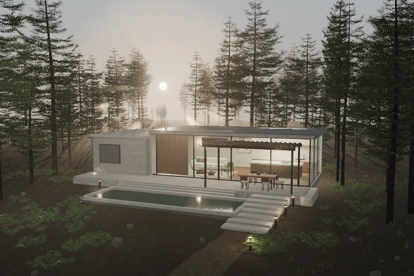
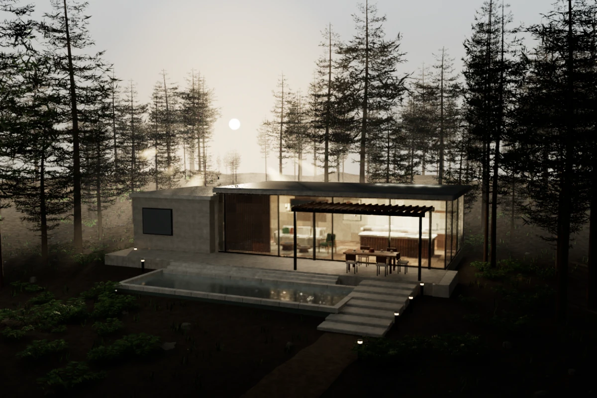
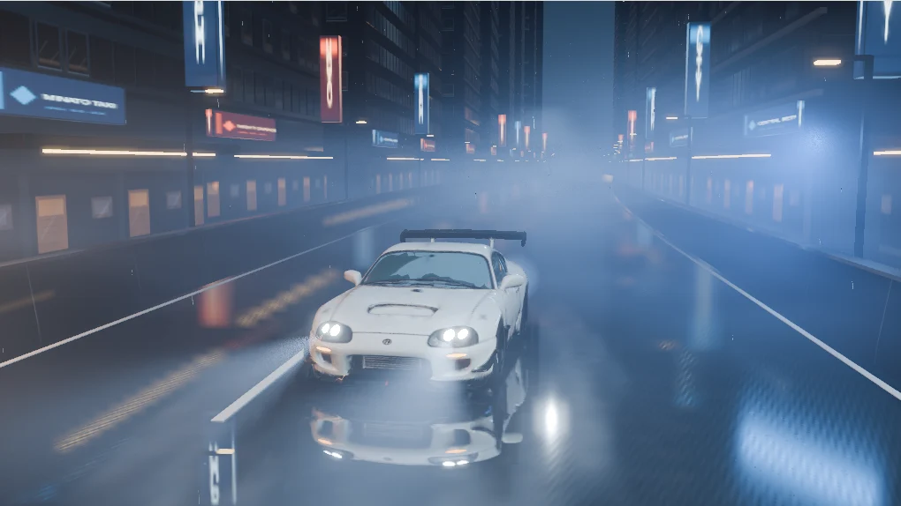
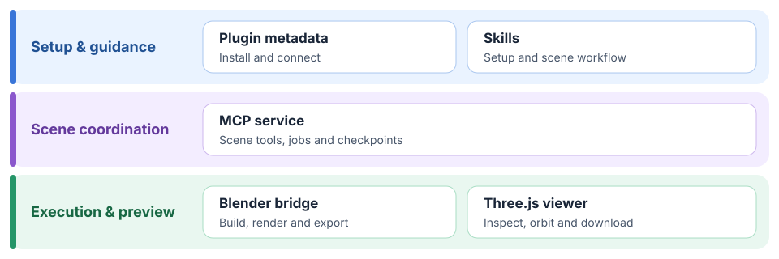

# UniBlenderScene

English | [简体中文](README.zh-CN.md)

A Blender scene creation and review plugin for **Codex**, **Claude Code**, and **Cursor**.

Turn reference images or text into editable Blender scenes. Combine your agent
harness with 3D APIs such as [Tripo](https://developers.tripo3d.ai/en/docs/introduction)
or [Meshy](https://docs.meshy.ai/en/api) to generate individual objects, then
assemble and refine the scene in Blender.

Deliver renders, `.blend` files and GLBs, with interactive 3D preview in
compatible MCP Apps hosts. Completed scenes can also be prepared for rendering
and interactive presentation with [Meshy's ThreeRT](https://github.com/meshy-dev/ThreeRT).

| Host | How to use it |
| --- | --- |
| Codex | Install the plugin; review renders and open interactive previews in an MCP Apps host |
| Claude Code | Load the plugin; inspect renders and access `.blend`/GLB files from the terminal |
| Cursor | Install locally with `npm run install:cursor` (or load via Cursor CLI); review renders and open interactive previews in Chat |
| Other agent harnesses | Connect to the MCP service and load the scene workflow instructions; preview support depends on the host |

## Showcases

<table>
  <tr>
    <th colspan="2" scope="colgroup">Forest house at sunset</th>
    <th colspan="2" scope="colgroup">Rainy city circuit</th>
  </tr>
  <tr>
    <th scope="col">Reference</th>
    <th scope="col">Blender</th>
    <th scope="col">Reference</th>
    <th scope="col">Blender</th>
  </tr>
  <tr>
    <td align="center" valign="middle"></td>
    <td align="center" valign="middle"></td>
    <td align="center" valign="middle"></td>
    <td align="center" valign="middle"></td>
  </tr>
  <tr>
    <th scope="col">Three.js</th>
    <th scope="col">ThreeRT</th>
    <th scope="col">Three.js</th>
    <th scope="col">ThreeRT</th>
  </tr>
  <tr>
    <td align="center" valign="middle"></td>
    <td align="center" valign="middle"></td>
    <td align="center" valign="middle"></td>
    <td align="center" valign="middle"></td>
  </tr>
</table>

The forest house was built from one reference. Three.js uses baked diffuse lighting on selected building surfaces. The ThreeRT image uses simplified tree geometry and is cropped to match the Blender framing.

The three rainy circuit renders use the same low-angle camera. The headlights illuminate thin mist ahead of the car, with broken white highlights on the wet road. Rows of lit office windows rise behind the storefronts. Three.js uses baked lightmaps for the road, barriers and storefronts and renders wet-road reflections in real time. Three.js and ThreeRT both apply the preview haze scale to the local dust and mist effects.

## What's in the plugin

Shared Skills guide planning and visual review, a dedicated Blender service
builds and renders the scene, and the viewer supports interactive inspection.
Codex, Claude Code, and Cursor use the same scene workflow.

Standalone objects use an applicable, separately configured 3D asset provider;
connect Tripo, Meshy or another provider through your agent harness's tools or
Skills. The agent imports the generated assets into Blender for placement and
scene review. Room surfaces and simple primitives can be procedural. If no
applicable provider is available, the workflow can fall back to Blender modeling.
Provider access, API keys and generation costs are configured separately. See the
[asset workflow](skills/blender-scene/references/assets.md).

## Quick start

Prerequisites: Node.js 22+ and Blender 4.5+ on the machine running the local
service. Ask your agent to read and follow the [quick-start guide](docs/quick-start.md)
to set up UniBlenderScene, or connect your host directly from the extracted
release ZIP (or after running `npm ci && npm run build` in a source checkout):

- **Codex:** add the plugin root as a local marketplace source and install
  `uni-blender-scene`. Codex starts or reuses the managed local service and
  dedicated Blender bridge automatically. See [Codex setup](docs/operations.md#codex).
- **Claude Code:** start the local service (`node --import tsx scripts/start-local.ts`
  from the plugin root), then launch `claude --plugin-dir /absolute/path/to/UniBlenderScene`
  from a separate scene directory. See [Claude Code setup](docs/operations.md#claude-code).
- **Cursor:** run `npm run install:cursor` from the plugin root, then restart
  Cursor or run `Developer: Reload Window`. The installer copies the plugin
  (Skills, workflow rule, and subagents) to `~/.cursor/plugins/local/uni-blender-scene`
  and registers `uni-blender-scene` in `~/.cursor/mcp.json` so Cursor Desktop
  auto-manages the local service and renders inline MCP Apps 3D previews in Chat.
  For Cursor CLI, run `agent --plugin-dir /absolute/path/to/UniBlenderScene`.
  See [Cursor setup](docs/operations.md#cursor).

## Scene workflow

The [scene Skill](skills/blender-scene/SKILL.md) guides a staged process:

1. **Plan:** identify the main objects, spatial relationships and visual goals.
2. **Build:** establish the full scene, then refine geometry and composition.
3. **Confirm:** review the neutral gray scene from multiple views—including
   frozen reference landmark and silhouette edge checks when reconstructing from
   images—and approve composition before materials and lighting begin.
4. **Refine:** use Leap for structural changes and Tweak for existing parameters.
   Compare material or lighting candidates against the same baseline when several
   directions are plausible, then render and review the selected edit.
   For reference-based scenes, compare every iteration with the original reference
   for that camera, including changes limited to the interactive preview.
   When a staged review does not pass, the workflow pauses and lists the unmet
   checks and visual differences so you can choose whether to continue revising
   the current phase or accept the listed differences and advance.
5. **Deliver:** export the best reviewed checkpoint as a render, `.blend` and GLB.

The agent supplies planning and visual judgment; the service executes Blender
operations, saves checkpoints and tracks review progress. See the
[workflow design](docs/scene-generation-preview.md) for details.

## Memory: learning across scene tasks

The workflow pairs an inner **edit → render → review → revise** loop with an
outer loop that captures lessons from completed scenes. Verified repairs can
become reusable guidance, Blender functions or checks after validation, and
later tasks can retrieve applicable entries.

Memory stays in the service's local data directory and survives restarts.
Learning runs during agent tasks; it does not change model weights. See the
[Scene Skill Library](skills/blender-skill-library/SKILL.md).

## Interactive 3D preview

Ask the agent to open the preview in a host that supports MCP Apps (such as
Codex or Cursor Desktop). You can:

- Orbit, zoom, pan and reset the camera.
- Click the Three.js or ThreeRT view: W/S moves along the viewing direction, including up or down when tilted; A/D moves sideways. Hold Shift to move faster.
- Select objects in the scene tree or 3D view to inspect their bounds.
- Switch between the Blender render and interactive 3D preview.
- Review neutral gray views, then approve composition or request changes in chat.

Use the gray views to check proportions and placement, and the Blender render
to review lighting and materials.

### ThreeRT preview

Explore your completed scene in ThreeRT to inspect its lighting, materials and
spatial depth from different viewpoints. When ThreeRT is available, completed
scenes open in this mode automatically.

Use the preview selector to switch to **Three.js · 网页交互** for quick
navigation and layout checks. Select **Render** to compare with the Blender
image. Appearance can differ between preview modes; use the Blender render
when reviewing the final look.

When the local 3D preview is ready, select **在浏览器中打开** to open it in your
browser. If the client cannot open it, copy the address from **查看预览链接**.

ThreeRT approximates Blender's HDR environment lighting with a gradient sky.
The native client displays the exported sky panorama (`background.exr`) when the
export includes one. See the
[upstream HDRI request](https://github.com/meshy-dev/ThreeRT/issues/178).

For static scenes, ask the agent to optimize the browser preview for smoother
navigation. If ThreeRT is unavailable, you can explore the scene with Three.js.
See [preview setup](docs/operations.md#threert-setup-and-limits) to enable ThreeRT.

## Related research

- [BlenderAlchemy: Editing 3D Graphics with Vision-Language Models](https://arxiv.org/abs/2404.17672)
  (Huang et al., 2024) inspired the plugin's Leap and Tweak edits and its
  candidate search for materials and lighting.
- [VIGA: Vision-as-Inverse-Graphics Agent via Interleaved Multimodal Reasoning](https://arxiv.org/abs/2601.11109)
  (Yin et al., 2026) describes a code, render, inspect, and revise loop for
  reconstructing editable scenes from images. Its visual feedback approach is
  relevant to this plugin's scene review workflow.
- [SceneCraft: An LLM Agent for Synthesizing 3D Scene as Blender Code](https://arxiv.org/abs/2403.01248)
  (Hu et al., 2024) uses scene planning, Blender Python generation, and rendered
  visual feedback to refine 3D scenes.

## Documentation

- [Quick-start guide](docs/quick-start.md): local dependency checks and
  host setup for Codex, Claude Code, and Cursor.
- [Service setup and deployment](docs/operations.md): local runtime, plugin
  source, remote connection, configuration, and packaging.
- [Scene Skill](skills/blender-scene/SKILL.md): scene workflow and tool use.
- [Validation results](docs/validation.md): checks performed for this release.

## Credits and upstream updates

The plugin includes [Scenario Blender Skills](skills/scenario-blender-expert/SKILL.md),
credited to Scenario Labs and its contributors under the
[MIT license](skills/scenario/LICENSE). See [upstream tracking](docs/scenario-skills.md)
for the pinned revision and update process.

Selected [EL4CTEO Blender Skills](https://github.com/EL4CTEO/blender-skills)
contribute time-of-day, weather and surface-texturing techniques under their
[MIT license](skills/blender-effects/LICENSE). See [effects integration](docs/blender-effects.md)
for the pinned sources, scene adapters and delivery limits.
