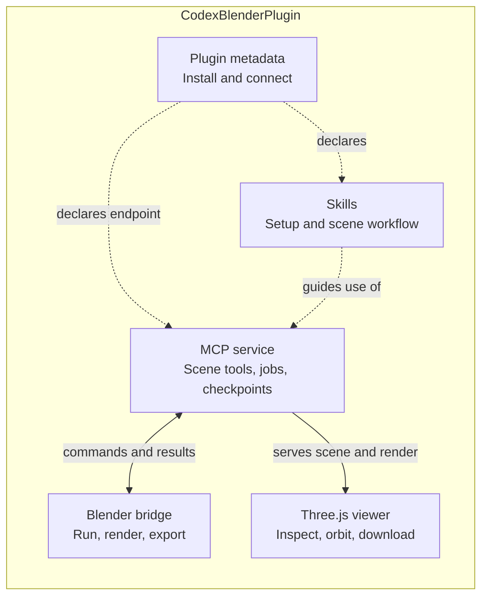

# CodexBlenderPlugin

Create and refine Blender scenes from reference images or text, inspect rendered
evidence, and preview the best result inside a supporting chat client.

## What's in the plugin

The plugin packages the instructions, scene tools, Blender integration, and
interactive preview needed to build and inspect a scene. This diagram shows the
packaged parts and their connections:



| Part | What it does | Main files |
| --- | --- | --- |
| Plugin metadata | Describes the plugin, its onboarding Skill, and the MCP connection. | [`plugin.json`](plugin.json), [`mcp.json`](mcp.json) |
| Skills | Explain setup and guide scene planning, editing, visual review, and optional 3D asset discovery. | [`skills/blender-setup/`](skills/blender-setup/SKILL.md), [`skills/blender-scene/`](skills/blender-scene/SKILL.md) |
| MCP service | Exposes scene tools, tracks jobs and review state, saves checkpoints, and provides artifact URLs. | [`src/server.ts`](src/server.ts), [`src/store.ts`](src/store.ts) |
| Blender bridge | Executes scene code in a dedicated Blender process, then renders and exports the result. | [`blender/bridge.py`](blender/bridge.py), [`blender/export.py`](blender/export.py) |
| Three.js viewer | Shows the render and orbitable GLB inside the chat, with scene downloads. | [`web/widget.ts`](web/widget.ts), [`web/widget.html`](web/widget.html) |

Optional Codex agent templates are in [`codex/agents/`](codex/agents/). A separate
3D generation tool can supply a detailed GLB for import; this plugin does not
include a 3D asset provider or its credentials.

## Quick start

Requirements: Node.js 22+, Blender 4.5+ with glTF export support, and a client that
supports HTTP MCP. The chat viewer additionally requires MCP Apps support and
WebGL 2. This release was tested with Blender 5.1.1 on macOS.

For demanding image-to-scene work, we recommend a paid ChatGPT plan with access
to Plugins and GPT-6.1 Sol or GPT-6 Astra. Model and plugin availability vary by
plan and workspace ([model guidance](https://learn.chatgpt.com/docs/models),
[plugin availability](https://developers.openai.com/training/walkthroughs/plugins-and-skills)).

From the repository root:

```bash
npm ci
npm run build
cp .env.example .env
```

Start a **dedicated** Blender process in one terminal. On macOS:

```bash
"/Applications/Blender.app/Contents/MacOS/Blender" \
  --background --factory-startup --python blender/bridge.py -- --port 9877
```

On Linux, use `blender` in place of the application path. On Windows, run the same
arguments with the path to `blender.exe`.

Start the service in a second terminal:

```bash
npm start
```

The default MCP endpoint is `http://127.0.0.1:4312/mcp`.
`http://127.0.0.1:4312/health` checks HTTP availability. A completed
`scene_create` job confirms the Blender connection.

The server and Blender must run on the same machine or share the same absolute
run directory. Runtime files are stored under `.canova/runs/<scene-id>/`.
Installing the plugin does not automatically start either process.

## Install in Codex or ChatGPT desktop

The repository includes a portable root `plugin.json`, `mcp.json`, and a repo
marketplace at `.agents/plugins/marketplace.json`.

In a Codex version that supports plugin marketplaces:

```bash
codex plugin marketplace add creativedswork/CodexBlenderPlugin --ref main
```

Private repositories require GitHub access. Alternatively, add the cloned
repository as a local marketplace:

```bash
codex plugin marketplace add /absolute/path/to/CodexBlenderPlugin
```

Restart the ChatGPT desktop app, open its Plugins Directory, select the
**Codex Blender** source, and install **CodexBlenderPlugin**. Client and workspace
availability can vary; see the
[official plugin packaging guide](https://developers.openai.com/plugins/build/plugins).

For a CLI that supports MCP but not plugin marketplaces:

```bash
codex mcp add codex-blender --url http://127.0.0.1:4312/mcp
```

Run from this repository so `AGENTS.md` applies, or install the
`skills/blender-scene` directory through your host's Skill mechanism. The MCP
server also exposes a `blender-scene` prompt for clients that support MCP prompts.
A client without MCP Apps can still create scenes and download artifacts.

## Connect from ChatGPT web

ChatGPT web needs a reachable HTTPS service; its servers cannot reach your
machine's `127.0.0.1`.

1. Deploy Node and a dedicated Blender process with a shared persistent run
   directory. Put the service behind an HTTPS reverse proxy.
2. Set `HOST=0.0.0.0`, a strong `MCP_API_KEY`, and
   `PUBLIC_BASE_URL=https://YOUR_SERVICE_ORIGIN` in the server environment.
   Forward `Host` and `Authorization` headers through the proxy.
3. Run `npm run configure -- https://YOUR_SERVICE_ORIGIN` to update the packaged
   MCP endpoint.
4. Register the HTTPS MCP connection in the host's custom plugin flow, using an
   authentication method the host supports. Keep the key in connection settings.
5. Test a new chat with an image attachment, then package the configured plugin
   with `npm run pack:plugin`.

The current service provides fixed bearer-key authentication for private
connections. The public submission portal does not accept API-key auth
connections; public-directory submission requires a supported authentication
integration such as OAuth. This release does not implement OAuth, submit to the
public directory, or provision HTTPS hosting. See
[authentication limitations](https://developers.openai.com/plugins/deploy/submission#authentication-limitations).

The viewer declares the service origin in its MCP Apps CSP metadata. Exported
artifacts use scoped URLs and CORS so the sandbox can load GLB, PNG, and EXR files.
Set `WIDGET_DOMAIN` only when your deployment has a dedicated UI origin.

## Use the plugin

Example request:

> Create a Blender scene matching this image. Preserve the camera composition,
> lighting and main objects, then show the interactive 3D result.

The bundled Skill guides the host through:

| Tool | Result |
| --- | --- |
| `scene_create` | Empty scene, optional reference image, asynchronous job ID |
| `scene_plan` | Frozen pre-export criteria, implementation steps and visual threshold |
| `scene_edit` | Checkpoint, execute Python, save and render |
| `scene_get` | Reference image, latest render, abbreviated object summary; `objectName` inspects one object's transforms without image bytes |
| `scene_review` | Pre-export render evidence, best checkpoint and convergence decision |
| `scene_export` | Best `.blend`, GLB, render profile and optional world EXR |
| `scene_view` | Lightweight job polling; embedded viewer with orbit controls and downloads |
| `scene_continue` | New user-requested refinement on the same scene |

Long Blender operations return immediately. The host and widget poll `scene_view`
for job status without image bytes. After a render completes, the host calls
`scene_get` to inspect the image before reviewing it. Pass `objectName` to
`scene_get` to inspect a named object's rotation mode, transforms, materials and
polygon count. The service does not judge images or generate Python.

The service enforces planning → editing → review, saves checkpoints before
edits, and restores failed edits. It allows 5 regular edit attempts, extending to
8 if the fifth review improves the best result and identifies repairable gaps.
Two consecutive non-improvements stop the request. Best-checkpoint ranking
uses unmet blockers, unmet major criteria, regressions, then the host's visual
score. Scores are judgments, not measured image-similarity metrics. Criteria
must be observable before export; verify GLB loading and viewer interaction
after `scene_export`, outside `scene_review`.

## Showcase: gamer bedroom from one photo

This example comes from a local Blender 5.1.1 run on 2026-11-04. The input was a
single gamer-bedroom photo showing a shelving desk, monitor, bed, curtain, PC
and black ergonomic chair.

| Input reference | Reviewed Blender render |
| --- | --- |
|  |  |

The input photo is included with the user's permission for this public showcase.
The `.blend` and GLB from that run remain local artifacts. A copyable request is:

> Build an orbitable 3D room from this photo. Match the camera composition and
> warm shelf lighting. If a detailed chair would improve the result, check the
> available image-to-3D tools and tell me the credit cost before generating it.
> Show a Blender render and an interactive 3D preview.

| Stage | What happened in this run |
| --- | --- |
| Scene layout | The host wrote Blender geometry for the desk, room, shelves, bed, curtain, PC and accessories through `scene_edit`. |
| Detailed asset | A separately configured Meshy 7.1 tool generated the chair from an isolated chair reference after the user confirmed 35 credits. The resulting mesh had 1,022,392 faces. Meshy is not bundled with this plugin. |
| Visual review | The host compared Blender renders with the photo and adjusted chair scale and orientation. Checking the imported object's rotation mode revealed that Euler-angle changes had been ignored while it was in `QUATERNION` mode. |
| Delivery | The reviewed scene was exported as a `.blend` and a 55 MB GLB; a Three.js browser check loaded the GLB and verified orbit dragging without page errors. |

The single photo does not show the room's hidden surfaces, so the orbitable model
is a reconstruction rather than an exact scan. The Blender PNG is the visual
reference for lighting and material comparison; WebGL may render them differently.

The viewer preserves the exported camera and aspect ratio, reconstructs lights,
loads EXR environments, applies AgX where configured, adds contact shadows, and
calibrates channel color statistics against the reviewed render at the initial
camera. This adjustment does not reproduce Blender's full lighting algorithm.
WebGL lighting, procedural shaders, volumes and compositing can differ from
Blender's renderer. The PNG remains the visual review evidence.

## Instructions and optional agents

`skills/blender-scene/SKILL.md` is the reusable host workflow.
`skills/blender-setup/SKILL.md` provides onboarding.
`AGENTS.md` applies when this repository is the agent's working directory; it is
not installed as global ChatGPT instructions.

Optional role templates are in `codex/agents/`. To register them in a Codex
project, copy them into that project's `.codex/agents/`. The coordinator can then
delegate sequentially to a builder and reviewer when the host supports subagents
and the user authorizes them. These prompts do not impose tool ACLs or create a
separate orchestrator. Portable plugin installation does not automatically load
the agent TOML files. See
[host orchestration](skills/blender-scene/references/orchestration.md).

## Configuration and access

See [.env.example](.env.example) for service, bridge and origin settings.
`FILE_DOWNLOAD_HOSTS` lists approved HTTPS reference-download domains. Default
entries allow those domains and their subdomains on port 443; an explicit
`hostname:port` entry permits only that exact host and port. Downloads revalidate
redirects, reject unsupported image signatures, and enforce a 20 MB limit.

This release serves one trusted operator and serializes all Blender operations.
`scene_edit` intentionally executes Python with Blender's OS permissions. Use a
dedicated account or container for hosted execution. The bridge listens on
localhost only. A bearer key is required when binding the HTTP service remotely.
Artifact links grant access to the files they expose; share them with intended
recipients only. The package excludes credentials and runtime files.

Scene metadata and reviewed checkpoints survive service restarts. Interrupted
edits restore the saved pre-edit checkpoint; interrupted jobs are reported as
failed. A disconnected or timed-out Blender operation may still be executing.
If recovery fails, stop and restart the dedicated bridge and service before
continuing. There is no multi-tenant isolation, job cancellation or process
supervisor in this release.

## Verify and package

```bash
npm run check
npm run build
npm test
npm run test:blender
```

The Blender integration check starts and stops its own bridge and HTTP service
on separate ports. It saves evidence outside the repository and prints
`evidenceDirectory`. Set `BLENDER_BIN` when Blender is installed elsewhere.

To verify the viewer with a sandboxed iframe and the official MCP AppBridge:

```bash
npx playwright install chromium
npm run test:viewer -- /path/printed/as/evidenceDirectory
```

`PLAYWRIGHT_CHROMIUM_EXECUTABLE` optionally selects an existing Chromium binary.
The iframe check uses the integration scene and a local test host; it does not
prove installation inside a user's ChatGPT account.

Create a distributable ZIP after building:

```bash
npm run pack:plugin
```

The archive is written to `../CodexBlenderPlugin.zip`. It contains the built
viewer and plugin source, excluding `.git`, `node_modules`, `.env` and `.canova`.
The source repository builds the viewer during setup.

See [validation results](docs/validation.md) for release checks and untested
deployment steps.
