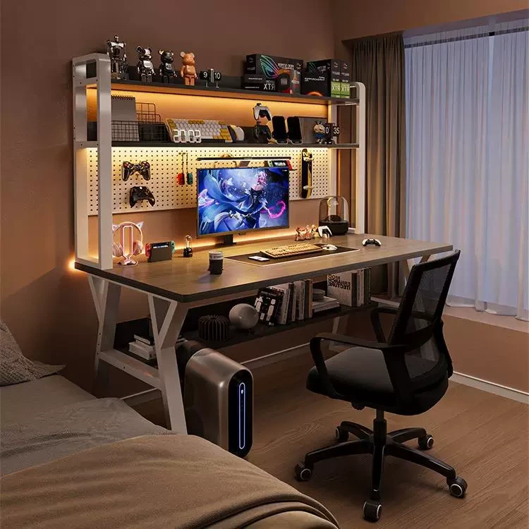
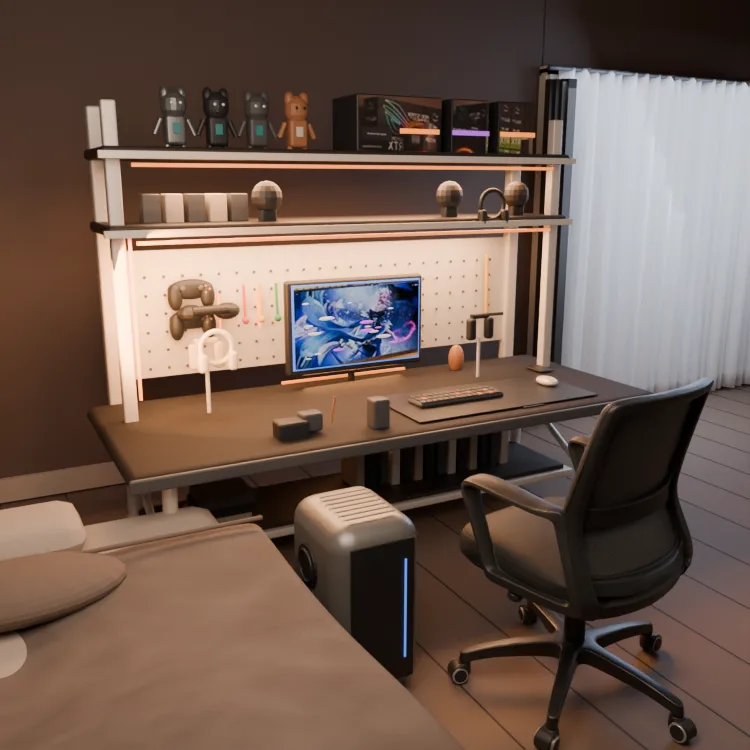

# CodexBlenderPlugin

Create and refine Blender scenes from reference images or text, then inspect the
render and orbitable 3D preview.

## What's in the plugin

The five modules are grouped by responsibility:

| Part | What it does | Main files |
| --- | --- | --- |
| Plugin metadata | Describes the plugin, its onboarding Skill, and the MCP connection. | [`plugin.json`](plugin.json), [`mcp.json`](mcp.json) |
| Skills | Explain setup and guide scene planning, editing, visual review, and optional 3D asset discovery. | [`skills/blender-setup/`](skills/blender-setup/SKILL.md), [`skills/blender-scene/`](skills/blender-scene/SKILL.md) |
| MCP service | Exposes scene tools, tracks jobs and review state, saves checkpoints, and provides artifact URLs. | [`src/server.ts`](src/server.ts), [`src/store.ts`](src/store.ts) |
| Blender bridge | Executes scene code in a dedicated Blender process, then renders and exports the result. | [`blender/bridge.py`](blender/bridge.py), [`blender/export.py`](blender/export.py) |
| Three.js viewer | Shows the render and a progressive path-traced GLB preview inside the chat, with scene downloads. | [`web/widget.ts`](web/widget.ts), [`web/widget.html`](web/widget.html) |

A separately configured 3D generation tool can supply a detailed GLB for import.
The plugin does not bundle a 3D asset provider or its credentials.

## Quick start

1. Install **CodexBlenderPlugin** from the **Codex Blender** plugin source.
   [Add the source](docs/operations.md#install-the-plugin-source) if it is not listed.
2. Start the [Blender MCP service](docs/operations.md#run-the-local-service), or
   [connect to a deployed service](docs/operations.md#connect-a-remote-service).
   The bundled connection points to `127.0.0.1`; installing the plugin does not
   start Blender or the service.
3. Attach an image or describe a scene, then ask for a render and interactive 3D
   preview. For example:

> Create a Blender scene matching this image. Preserve the camera composition,
> lighting and main objects, then show the interactive 3D result.

For complex image-to-scene work, we recommend a paid ChatGPT plan with plugin
access and GPT-6.1 Sol or GPT-6 Astra ([model guidance](https://learn.chatgpt.com/docs/models)).

## Scene workflow

The [scene Skill](skills/blender-scene/SKILL.md) describes this tool sequence:

| Tool | Result |
| --- | --- |
| `scene_create` | Create a scene with an optional reference image |
| `scene_plan` | Set the scene plan and review criteria |
| `scene_edit` | Run Blender code, save and render |
| `scene_get` | Inspect the scene and latest render |
| `scene_review` | Review the render and select the best checkpoint |
| `scene_export` | Export `.blend` and GLB files |
| `scene_view` | Check progress and open the interactive viewer |
| `scene_continue` | Refine an existing scene |

The service saves a checkpoint before each edit and exports the best reviewed scene.

## Showcase: gamer bedroom from one photo

This scene was built from one photo in Blender 5.1.1.

| Input reference | Reviewed Blender render |
| --- | --- |
|  |  |

The input photo is included with the user's permission. The request was to build
a high-fidelity 3D scene matching the photo.

The room and chair were modeled in Blender. The monitor uses generated fantasy
artwork. The reviewed scene was exported as `.blend` and GLB; static surfaces
were baked into the GLB to bring the interactive preview's lighting closer to
the Blender render. The current viewer traces scene lights, contact shadows,
indirect light, and reflections; older GLBs need re-export to gain the exported
Blender display transform. The Three.js preview was checked for orbit interaction.
The scene is a reconstruction: the photo does not show the room's hidden sides.
The `.blend` and GLB from this run remain local artifacts.

## Related research

- [VIGA: Vision-as-Inverse-Graphics Agent via Interleaved Multimodal Reasoning](https://arxiv.org/abs/2601.11109)
  (Yin et al., 2026) describes a code, render, inspect, and revise loop for
  reconstructing editable scenes from images. Its visual feedback approach is
  relevant to this plugin's scene review workflow.
- [SceneCraft: An LLM Agent for Synthesizing 3D Scene as Blender Code](https://arxiv.org/abs/2403.01248)
  (Hu et al., 2024) uses scene planning, Blender Python generation, and rendered
  visual feedback to refine 3D scenes.

## Documentation

- [Service setup and deployment](docs/operations.md): local runtime, plugin
  source, remote connection, configuration, and packaging.
- [Scene Skill](skills/blender-scene/SKILL.md): scene workflow and tool use.
- [Validation results](docs/validation.md): checks performed for this release.

## Credits and upstream updates

The [scene craft guidance](skills/blender-scene/references/scene-craft.md) adapts
methods from [Scenario Labs' Blender Expert Skills](https://github.com/scenario-labs/skills/tree/main/skills/dcc/blender)
(MIT). Thanks to Scenario Labs and its contributors. The plugin does not bundle
their scripts or MCP service. See [upstream tracking](docs/scenario-skills.md)
for the reviewed version and `npm run check:scenario-skills` update check.
