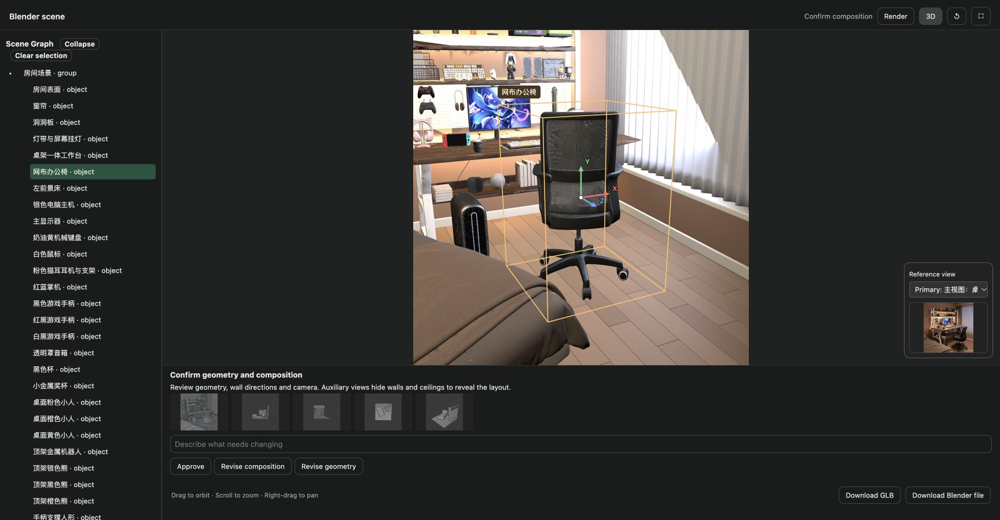

# CodexBlenderPlugin

Create and refine Blender scenes from reference images or text, then inspect the
render and interactive Three.js preview with a selectable scene tree.

## Showcase: gamer bedroom from multiple views

This reconstruction uses three reference views in Blender 5.1.1. The images
below show the current composition checkpoint, pending user approval.

| Reference room | Blender composition checkpoint |
| --- | --- |
|  |  |

The reference image is included with the user's permission. The request was to
reconstruct the room as closely as possible, using the primary view for composition
and the other views for equipment details and spatial layout.

Standalone furniture, equipment, and accessories use externally generated GLB
assets assembled in Blender, with procedural room surfaces and fittings. The
monitor uses artwork extracted from the supplied screen image. The current
checkpoint is iteration 8; material and lighting refinement is still pending.
It does not yet establish a 1:1 reconstruction. Scene files remain local artifacts.

The Chrome screenshot shows the bundled viewer in a local MCP Apps host. Selecting
the chair in the Scene Graph focuses it and displays its bounds; the selection
stays aligned while orbiting. The review panel retains the five neutral views
and composition decision controls. The browser host used for this check is a
local session helper; it is not a packaged standalone preview server.

## What's in the plugin

The five modules are grouped by responsibility:

| Part | What it does | Main files |
| --- | --- | --- |
| Plugin metadata | Describes the plugin, its onboarding Skill, and the MCP connection. | [`plugin.json`](plugin.json), [`mcp.json`](mcp.json) |
| Skills | Explain setup and guide scene planning, editing, visual review, required single-object Provider discovery, and bundled Blender production techniques. | [`skills/blender-setup/`](skills/blender-setup/SKILL.md), [`skills/blender-scene/`](skills/blender-scene/SKILL.md), [`skills/scenario-blender-*/`](skills/scenario-blender-expert/SKILL.md) |
| MCP service | Exposes scene tools, tracks jobs and review state, saves checkpoints, and provides artifact URLs. | [`src/server.ts`](src/server.ts), [`src/store.ts`](src/store.ts) |
| Blender bridge | Executes scene code in a dedicated Blender process, then renders and exports the result. | [`blender/bridge.py`](blender/bridge.py), [`blender/export.py`](blender/export.py) |
| Three.js viewer | Shows the render, progressive path-traced GLB preview, selectable scene tree, and composition review controls inside an MCP Apps host. | [`web/widget.ts`](web/widget.ts), [`web/widget.html`](web/widget.html) |

Standalone objects must use an applicable separately configured 3D API Provider.
Blender modeling is the fallback only when discovery finds no applicable Provider.
Geometry plans record each object strategy and its downloaded GLB provenance;
room surfaces and simple primitives can be procedural.
The plugin does not bundle a 3D asset provider or its credentials.

## Quick start

1. Install **CodexBlenderPlugin** from the **Codex Blender** plugin source.
   [Add the source](docs/operations.md#install-the-plugin-source) if it is not listed.
2. Start the [Blender MCP service](docs/operations.md#run-the-local-service), or
   [connect to a deployed service](docs/operations.md#connect-a-remote-service).
   The bundled connection points to `127.0.0.1`; installing the plugin does not
   start Blender or the service.
3. Attach an image or describe a scene, then ask for a render and interactive 3D
   preview. For example:

> Create a Blender scene matching this image. Preserve the camera composition,
> lighting and main objects, then show the interactive 3D result.

For complex image-to-scene work, we recommend a paid ChatGPT plan with plugin
access and GPT-6.1 Sol or GPT-6 Astra ([model guidance](https://learn.chatgpt.com/docs/models)).

## Scene workflow

The [scene Skill](skills/blender-scene/SKILL.md) describes this tool sequence:

| Tool | Result |
| --- | --- |
| `scene_create` | Create a scene with an optional reference image |
| `scene_plan` | Set criteria, required Scene Graph and assets, and stage budgets |
| `scene_plan_review` | Verify graph coverage and spatial relationships against every view |
| `scene_asset_strategy` | Record Provider discovery and local GLB, or no-Provider Blender fallback |
| `scene_graph` | Update graph names and completion states during editing |
| `scene_edit` | Run Blender code, save and render |
| `scene_get` | Inspect the scene and latest render |
| `scene_review` | Review the render and select the best checkpoint |
| `scene_review_decision` | Approve or revise the geometry and composition checkpoint |
| `scene_review_views` | Retry generation of the five confirmation views |
| `scene_preview` | Prepare the pending composition checkpoint for interactive 3D inspection without approving it |
| `scene_export` | Export the best reviewed `.blend` and GLB after completion |
| `scene_view` | Check progress and open the interactive viewer |
| `scene_continue` | Refine an existing scene |

The service saves a checkpoint before each edit, supplies an iteration-bound inspection, and exports the best reviewed scene. See the [0.2.0 acceptance checklist](docs/acceptance-0.2.0.md) for Provider, multi-view and approval checks.
For full reconstructions, the plan runs ordered geometry, composition,
materials, lighting, and final stages with one budget per stage. Composition
approval is mandatory before materials; five neutral Blender views are
available in the widget. The explicit decision tool resumes from the saved
checkpoint or returns to geometry or composition with feedback.

An image-based request must pass its image through `scene_create.reference`; the
service rejects a text-only create when the request refers to an image. The
scene Skill directs the first edit to build a complete scene blockout, then later edits refine bounded
parts. The scene Skill supplies the same pinned Scenario Blender production
knowledge revision as Canova, adapted to this plugin's host-driven tools.
For reference images, the host records major regions in normalized image
coordinates and measures them in each render. The service checks those submitted
measurements and keeps composition open when a region edge differs by more than
8% of the frame; it does not detect objects in images on its own.

## Interactive 3D preview

At the composition checkpoint (`awaiting_review`), call `scene_preview` with the
scene ID, then poll `scene_view` until the preview job finishes. The viewer loads
the best checkpoint's GLB, render profile, and Scene Graph. Preparing this preview
preserves the checkpoint, pending approval, and stage budget. Final
`scene_export` remains blocked until the workflow reaches `completed` or
`best_effort`; only `scene_review_decision` records the user's decision.

The Scene Graph uses stable `scene_node_id` properties on Blender objects.
Export includes `scene-graph.json` and `manifest.json`, and checks that built
objects map to GLB meshes. Organizational groups can use their descendants'
meshes. The viewer supports:

- Select a tree node to frame the object or group and show its orange 3D bounds
  with red X, green Y, and blue Z direction arrows.
- Click a mesh to select its tree entry while preserving the camera view.
- Orbit, zoom, pan, and reset the camera. Bounds stay aligned with the selection.
- Click empty space, press Escape, or use **Clear selection** to deselect.
- Switch between the Blender render and 3D preview; review the five neutral views
  before approving or requesting changes to composition.

The arrows show world-axis directions and do not edit transforms. Blender renders
remain the visual review source. The viewer requires an MCP Apps host and WebGL 2;
the MCP endpoint itself is not a Chrome preview page. See the
[viewer checklist](docs/acceptance-0.2.1.md) and
[service setup](docs/operations.md#open-the-interactive-preview).

## Multiple reference views

Supply up to 6 images of the same scene in `scene_create.references`. The first
image defines the primary camera and composition; auxiliary images clarify
depth, occlusion, and relative object positions. Each file can include a short
`label`, such as "right side". The original single-image `reference` input is
still supported. Use `scene_continue.references` to append views to a delivered
scene while preserving its primary image, with at most 6 references in total.

`scene_get` returns all labeled images, or one image selected by `referenceName`.
The embedded viewer lets users select and enlarge any reference. In clients
that expose file upload, select multiple images, choose the primary view, then
create a scene or add views to the current scene. The host model reconciles the
views during planning and spatial review; image-space alignment uses the primary
view. This input support does not automatically estimate calibrated cameras or
triangulate geometry.

In local Codex, attach the images to the conversation and ask to use the Blender
scene plugin. Each reference can use `local_path` instead of `download_url` and
`file_id`. The local service must enable the image directories with
`LOCAL_REFERENCE_ROOTS` (platform path separator). Local files are disabled by
default; approved files are copied into the scene and checked for PNG/JPEG/WebP
content and the 20 MB limit. Reinstall an updated local plugin, then restart
Codex and use a new conversation to load its tools and instructions.

## Related research

- [VIGA: Vision-as-Inverse-Graphics Agent via Interleaved Multimodal Reasoning](https://arxiv.org/abs/2601.11109)
  (Yin et al., 2026) describes a code, render, inspect, and revise loop for
  reconstructing editable scenes from images. Its visual feedback approach is
  relevant to this plugin's scene review workflow.
- [SceneCraft: An LLM Agent for Synthesizing 3D Scene as Blender Code](https://arxiv.org/abs/2403.01248)
  (Hu et al., 2024) uses scene planning, Blender Python generation, and rendered
  visual feedback to refine 3D scenes.

## Documentation

- [Service setup and deployment](docs/operations.md): local runtime, plugin
  source, remote connection, configuration, and packaging.
- [Scene Skill](skills/blender-scene/SKILL.md): scene workflow and tool use.
- [Validation results](docs/validation.md): checks performed for this release.

## Credits and upstream updates

The [scene Skill](skills/blender-scene/SKILL.md) is installed alongside the
[Scenario Blender Skills](skills/scenario-blender-expert/SKILL.md). Each domain
has a directly loadable `SKILL.md` and retains its pinned upstream source as
`UPSTREAM.md`. The original files and [MIT license](skills/scenario/LICENSE)
are credited to Scenario Labs and its contributors. Scene edits still run only
through this plugin's dedicated bridge. See [upstream tracking](docs/scenario-skills.md)
for the pinned revision and `npm run check:scenario-skills` update check.
