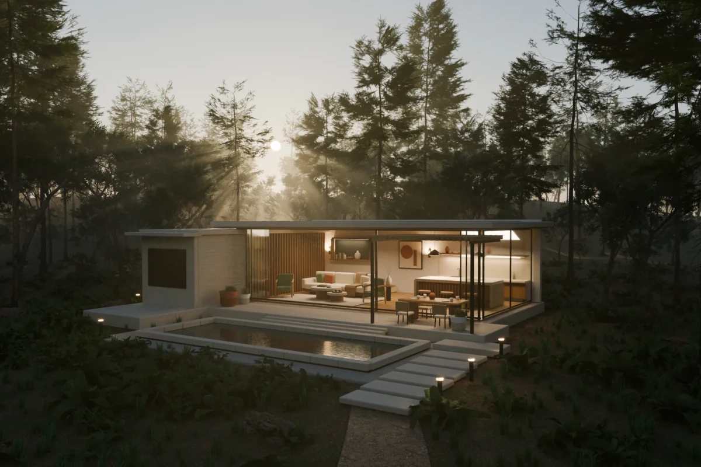
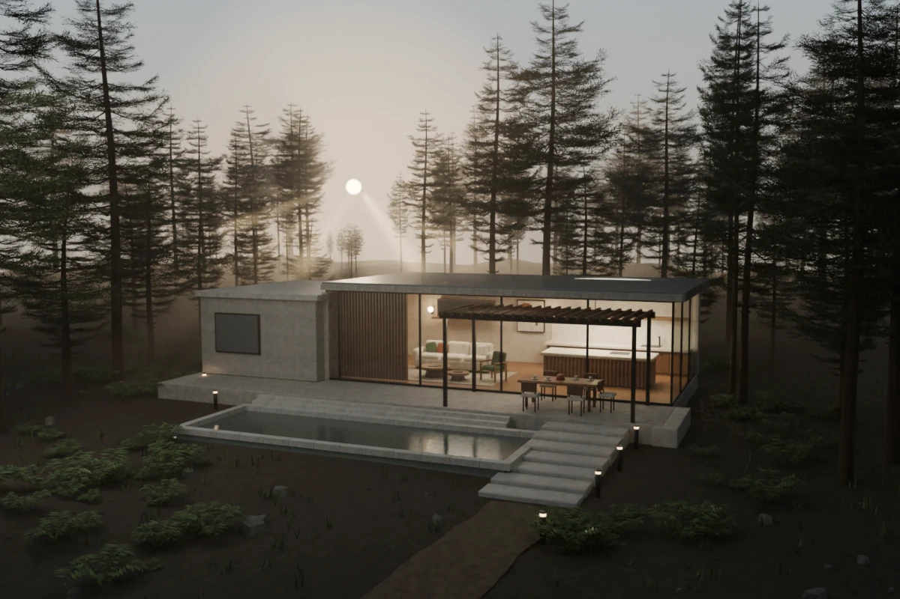
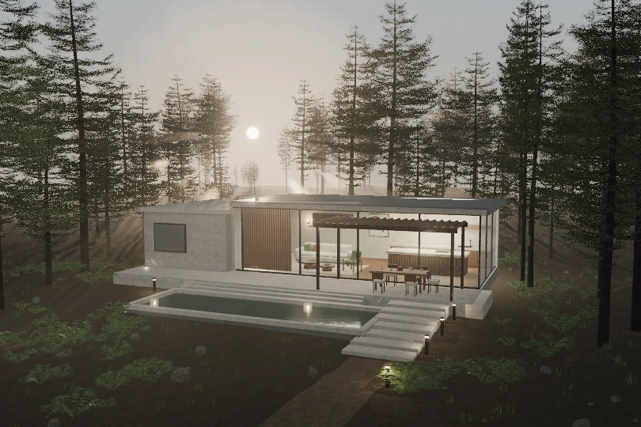

# UniBlenderScene

[English](README.md) | 简体中文

面向 **Codex** 和 **Claude Code** 的 Blender 场景创建与复核插件。

将参考图或文字描述转化为可编辑的 Blender 场景。通过 Agent 运行环境（Agent harness）配合 [Tripo](https://developers.tripo3d.ai/en/docs/introduction)、[Meshy](https://docs.meshy.ai/en/api) 等 3D API 生成单体资产，再在 Blender 中组装和细化场景。

交付渲染图、`.blend` 和 GLB 文件，并在支持 MCP Apps 的客户端中提供交互式 3D 预览。完成的场景还可以转换到 [Meshy 的 ThreeRT](https://github.com/meshy-dev/ThreeRT)，用于渲染和交互展示。

| Agent 运行环境 | 使用方式 |
| --- | --- |
| Codex | 安装插件，查看渲染图，并在支持 MCP Apps 的客户端中打开交互预览 |
| Claude Code | 加载插件，在终端中查看渲染图并获取 `.blend` / GLB 文件 |
| 其他 Agent 运行环境 | 连接 MCP 服务并加载场景工作流指引；预览能力取决于客户端 |

## 效果展示 · 夕阳下的林间住宅

根据一张参考图，在 Blender 中重建玻璃住宅、水池和四周的松林。下方对照原始参考、Blender 成片和导出后的两种预览。

<table>
  <tr>
    <th width="50%">参考图</th>
    <th width="50%">Blender</th>
  </tr>
  <tr>
    <td align="center" valign="top"></td>
    <td align="center" valign="top"></td>
  </tr>
  <tr>
    <th>Three.js</th>
    <th>ThreeRT</th>
  </tr>
  <tr>
    <td align="center" valign="top"></td>
    <td align="center" valign="top"></td>
  </tr>
</table>

ThreeRT 图使用了简化后的树木几何。不同渲染器的雾、阴影和倒影表现有所差异。

## 插件包含什么

共享 Skills 指导场景规划和视觉复核，专用 Blender 服务负责构建与渲染，预览器支持交互检查。Codex 和 Claude Code 使用同一套场景工作流。

独立物体使用适用且已单独配置的 3D 资产服务。通过 Agent 运行环境中的工具或 Skills 接入 Tripo、Meshy 等服务后，Agent 会将生成的资产导入 Blender，进行摆放与场景复核。房间表面和简单几何体可以程序化生成；没有适用的资产服务时，工作流可回退到 Blender 建模。服务访问权限、API Key 和生成费用需要单独配置。详见[资产工作流](skills/blender-scene/references/assets.md)。

## 快速开始

让 Agent 阅读并执行[快速开始文档](docs/quick-start.md)，完成 UniBlenderScene 的安装与配置。

## 场景工作流

[场景 Skill](skills/blender-scene/SKILL.md) 指导以下分阶段流程：

1. **规划：** 明确主要物体、空间关系和视觉目标。
2. **构建：** 先搭建完整场景，再细化几何与构图。
3. **确认：** 从多个视角检查灰模场景，确认构图后再开始制作材质和灯光。
4. **细化：** 添加材质与灯光，每轮修改后渲染并复核。
5. **交付：** 将复核后的最佳检查点导出为渲染图、`.blend` 和 GLB。

Agent 负责规划和视觉判断；服务负责执行 Blender 操作、保存检查点并跟踪复核进度。详见[工作流设计](docs/scene-generation-preview.md)。

## 记忆：跨场景任务积累经验

工作流将 **编辑 → 渲染 → 复核 → 修正** 的内循环，与从已完成场景中积累经验的外循环结合。经过验证的修复方法可在进一步校验后沉淀为可复用的指引、Blender 函数或检查项，供后续任务检索和使用。

记忆保存在服务本地的数据目录中，重启后仍会保留。学习在 Agent 执行任务期间进行，不会改变模型权重。详见[经验工作流](skills/blender-scene/references/experience.md)。

## 交互式 3D 预览

在支持 MCP Apps 的客户端中，让 Agent 打开预览。你可以：

- 旋转视角、缩放、平移和重置相机。
- 点击 Three.js 或 ThreeRT 画面后，W/S 沿视线前后移动，俯视或仰视时可改变高度；A/D 左右平移，按住 Shift 加速。
- 在场景树或 3D 视图中选择物体，检查其边界框。
- 在 Blender 渲染图和交互式 3D 预览之间切换。
- 查看中性灰模视图，然后在聊天中确认构图或提出修改。

通过灰模视图检查比例和摆放，再用 Blender 渲染图确认灯光与材质。

### ThreeRT 预览

通过 ThreeRT 从不同视角浏览完成的场景，检查灯光、材质和空间层次。ThreeRT 可用时，完成的场景会默认打开这一预览模式。

想快速漫游、检查物体摆放时，在预览器中切换到 **Three.js · 网页交互**；选择 **Render** 可对照 Blender 渲染图。不同预览模式的外观可能有差异，确认最终效果时以 Blender 渲染图为准。

对于静态场景，可以让 Agent 优化浏览器预览，让漫游更流畅。ThreeRT 不可用时，仍可通过 Three.js 浏览场景。启用方式见[预览配置](docs/operations.md#threert-setup-and-limits)。

## 相关研究

- [VIGA: Vision-as-Inverse-Graphics Agent via Interleaved Multimodal Reasoning](https://arxiv.org/abs/2601.11109)（Yin 等，2026）通过生成代码、渲染、观察和修正的循环，从图片重建可编辑场景。其视觉反馈方法与本插件的场景复核流程相关。
- [SceneCraft: An LLM Agent for Synthesizing 3D Scene as Blender Code](https://arxiv.org/abs/2403.01248)（Hu 等，2024）通过场景规划、Blender Python 生成和渲染反馈来细化 3D 场景。

## 文档

- [服务配置与部署](docs/operations.md)：本地运行、插件源、远程连接、配置和打包。
- [场景 Skill](skills/blender-scene/SKILL.md)：场景工作流与工具使用。
- [验证结果](docs/validation.md)：本版本已执行的检查。

## 致谢与上游更新

插件包含 [Scenario Blender Skills](skills/scenario-blender-expert/SKILL.md)，原作者为 Scenario Labs 及其贡献者，采用 [MIT 许可证](skills/scenario/LICENSE)。固定的上游版本与更新流程详见[上游跟踪](docs/scenario-skills.md)。
