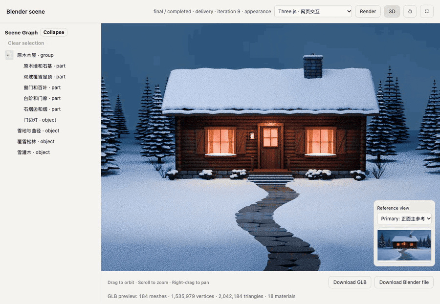
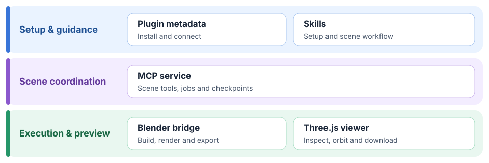

# UniBlenderScene

[English](README.md) | 简体中文

面向 **Codex** 和 **Claude Code** 的 Blender 场景创建与复核插件。

将参考图或文字描述转化为可编辑的 Blender 场景。通过 Agent 运行环境（Agent harness）配合 [Tripo](https://developers.tripo3d.ai/en/docs/introduction)、[Meshy](https://docs.meshy.ai/en/api) 等 3D API 生成单体资产，再在 Blender 中组装和细化场景。

交付渲染图、`.blend` 和 GLB 文件，并在支持 MCP Apps 的客户端中提供交互式 3D 预览。完成的场景还可以转换到 [Meshy 的 ThreeRT](https://github.com/meshy-dev/ThreeRT)，用于渲染和交互展示。

| Agent 运行环境 | 使用方式 |
| --- | --- |
| Codex | 安装插件，查看渲染图，并在支持 MCP Apps 的客户端中打开交互预览 |
| Claude Code | 加载插件，在终端中查看渲染图并获取 `.blend` / GLB 文件 |
| 其他 Agent 运行环境 | 连接 MCP 服务并加载场景工作流指引；预览能力取决于客户端 |

## 效果展示：蓝调时刻的冬日木屋

根据一张参考图在 Blender 中重建场景。灰模构图确认后，再添加纹理、冷色室外灯光、温暖的窗光和烟囱烟雾。下方依次为参考图、Blender 渲染图和 ThreeRT 渲染图。

<table>
  <tr>
    <th width="33%">参考图</th>
    <th width="33%">Blender 渲染</th>
    <th width="33%">ThreeRT 渲染</th>
  </tr>
  <tr>
    <td align="center" valign="top"></td>
    <td align="center" valign="top"></td>
    <td align="center" valign="top"></td>
  </tr>
</table>

这个风格化重建案例采用本地 Blender 建模，部分植被和石径细节有所简化。两个渲染器在天空亮度、窗光颜色和烟雾表现上存在差异。



选择 Scene Graph（场景图谱）中的节点，即可聚焦对应物体并显示边界框和 XYZ 坐标轴。旋转视角时，Three.js 预览中的选中标记会随物体更新。

## 插件包含什么



共享 Skills 指导场景规划和视觉复核，专用 Blender 服务负责构建与渲染，预览器支持交互检查。Codex 和 Claude Code 使用同一套场景工作流。

独立物体使用适用且已单独配置的 3D 资产服务。通过 Agent 运行环境中的工具或 Skills 接入 Tripo、Meshy 等服务后，Agent 会将生成的资产导入 Blender，进行摆放与场景复核。房间表面和简单几何体可以程序化生成；没有适用的资产服务时，工作流可回退到 Blender 建模。服务访问权限、API Key 和生成费用需要单独配置。详见[资产工作流](skills/blender-scene/references/assets.md)。

## 快速开始

先准备环境，再按以下四步，在 macOS 或 Linux 上通过 Codex 体验第一个本地场景。

### 准备环境

本地创建场景必须安装 Blender。local launcher 会启动已安装的 Blender 和 MCP 服务，**不会安装 Blender 或 Node.js**。

| 依赖 | 安装与检查 |
| --- | --- |
| Node.js 22+ 和 npm | 从 [Node.js 下载页](https://nodejs.org/en/download)安装，再运行 `node --version` 和 `npm --version` 检查。 |
| Blender 4.5+ | 从 [Blender 下载页](https://www.blender.org/download/)下载安装包，按下方对应平台的说明安装。 |
| Git 和 Codex | 安装后运行 `git --version` 和 `codex --version` 检查，并登录 Codex。 |
| `lsof` 和 `ps` | 运行 `command -v lsof` 和 `command -v ps` 检查。若缺失，通过系统包管理器安装。 |

- **macOS：** 打开下载的 Blender `.dmg`，将 `Blender.app` 拖入 `/Applications`。可参照 [macOS 安装指南](https://docs.blender.org/manual/en/latest/getting_started/installing/macos.html)，然后检查：

  ```bash
  "/Applications/Blender.app/Contents/MacOS/Blender" --version
  ```

- **Linux：** 下载适合本机架构的 Blender 压缩包并解压，详见 [Linux 安装指南](https://docs.blender.org/manual/en/latest/getting_started/installing/linux.html)。若 `blender` 已在 `PATH` 中，运行 `blender --version`；否则运行 `"/absolute/path/to/extracted-blender/blender" --version`，并在第 2 步将该可执行文件路径设为 `BLENDER_BIN`。

确认 Blender 输出的版本为 4.5 或以上，再继续。如果检查提示命令或文件不存在，请先完成对应依赖的安装。

### 创建第一个场景

1. **下载并准备插件。** 在终端中执行：

   ```bash
   git clone https://github.com/creativedswork/UniBlenderScene.git
   cd UniBlenderScene
   npm ci
   npm run build
   pwd
   ```

   `pwd` 输出的目录就是 **plugin source（插件源目录）**，即包含 `plugin.json`、`mcp.json`、`skills/` 和 `.agents/plugins/marketplace.json` 的仓库根目录。添加插件源时使用这个根目录。

2. **同时启动 Blender 和 MCP 服务。** 在同一个终端、上述仓库根目录中执行：

   ```bash
   node --import tsx scripts/start-local.ts
   ```

   macOS 默认使用 `/Applications/Blender.app/Contents/MacOS/Blender`；Linux 使用 `PATH` 中的 `blender`。如果安装在其他位置，执行 `BLENDER_BIN="/absolute/path/to/blender" node --import tsx scripts/start-local.ts`。
   看到 `Ready: http://127.0.0.1:4312/mcp (...)` 后继续。启动脚本退出后，这两个进程仍会保持运行。

3. **在 Codex 中安装插件。** 仍在仓库根目录中，注册本地插件源：

   ```bash
   codex plugin marketplace add "$PWD"
   ```

   在 Codex 的 Plugins Directory 中找到 **UniBlenderScene** 插件源，安装 **UniBlenderScene**。界面中的插件源名称对应上一步注册的仓库目录。

4. **创建第一个场景。** 新建一个独立的场景项目目录：

   ```bash
   mkdir -p ../UniBlenderScenes
   ```

   在 Codex 中将该目录作为项目打开，并新建聊天以加载已安装的插件。发送：

   > 使用 UniBlenderScene 创建一个简单房间，包含地板、两面墙、一个立方体底座和底座上的球体。使用程序化几何体和温暖的灯光。先暂停让我确认构图，再交付渲染图、可编辑的 .blend 文件和 GLB。如果当前客户端支持，请打开交互式预览。

   Agent 展示灰模构图后，检查结果并回复 **确认构图，继续制作材质和灯光**，或描述需要修改的地方。细化完成后，Agent 会提供渲染图和场景文件。交互式预览需要客户端支持 MCP Apps。

### 单独操作与配置

后续再次使用，或需要调整某个步骤时：

| 操作 | 方法 |
| --- | --- |
| 再次启动本地服务 | 在插件源目录运行 `node --import tsx scripts/start-local.ts`，脚本会复用由它启动且仍在运行的进程。详见[启动脚本行为与日志](docs/operations.md#start-the-local-processes-together)。 |
| 分别启动 Blender 和 MCP 服务 | 参照[手动启动服务](docs/operations.md#run-the-local-service)，分别运行 Blender bridge 命令和 `npm start`。 |
| 使用 Claude Code | 参照 [Claude Code 配置](docs/operations.md#claude-code)，在独立场景项目中加载同一个插件。 |
| 用 Tripo 或 Meshy 生成物体 | 将资产服务的工具或 Skill 接入 Agent 运行环境，配置 API 访问权限，再让 Agent 使用它生成场景资产。详见[资产工作流](skills/blender-scene/references/assets.md)。 |
| 用 ThreeRT 展示结果 | 安装原生客户端并配置 `THREERT_BIN`，再让 Agent 用 ThreeRT 渲染或打开完成的场景。详见 [ThreeRT 预览](#threert-预览)。 |
| 使用参考图 | 附加最多 6 张同一场景的图片，并指定主视角。本地文件访问需配置 `LOCAL_REFERENCE_ROOTS`，详见[配置与访问](docs/operations.md#configuration-and-access)。 |
| 连接远程服务 | 参照[远程服务配置](docs/operations.md#connect-a-remote-service)。 |

## 场景工作流

[场景 Skill](skills/blender-scene/SKILL.md) 指导以下分阶段流程：

1. **规划：** 明确主要物体、空间关系和视觉目标。
2. **构建：** 先搭建完整场景，再细化几何与构图。
3. **确认：** 从多个视角检查灰模场景，确认构图后再开始制作材质和灯光。
4. **细化：** 添加材质与灯光，每轮修改后渲染并复核。
5. **交付：** 将复核后的最佳检查点导出为渲染图、`.blend` 和 GLB。

Agent 负责规划和视觉判断；服务负责执行 Blender 操作、保存检查点并跟踪复核进度。详见[工作流设计](docs/scene-generation-preview.md)。

## 记忆：跨场景任务积累经验

工作流将 **编辑 → 渲染 → 复核 → 修正** 的内循环，与从已完成场景中积累经验的外循环结合。经过验证的修复方法可在进一步校验后沉淀为可复用的指引、Blender 函数或检查项，供后续任务检索和使用。

记忆保存在服务本地的数据目录中，重启后仍会保留。学习在 Agent 执行任务期间进行，不会改变模型权重。详见[经验工作流](skills/blender-scene/references/experience.md)。

## 交互式 3D 预览

在支持 MCP Apps 的客户端中，让 Agent 打开预览。你可以：

- 旋转视角、缩放、平移和重置相机。
- 点击 Three.js 或 ThreeRT 画面后，W/S 沿视线前后移动，俯视或仰视时可改变高度；A/D 左右平移，按住 Shift 加速。
- 在场景树或 3D 视图中选择物体，检查其边界框。
- 在 Blender 渲染图和交互式 3D 预览之间切换。
- 查看中性灰模视图，然后在聊天中确认构图或提出修改。

通过灰模视图检查比例和摆放，再用 Blender 渲染图确认灯光与材质。

### ThreeRT 预览

通过 ThreeRT 从不同视角浏览完成的场景，检查灯光、材质和空间层次。ThreeRT 可用时，完成的场景会默认打开这一预览模式。

想快速漫游、检查物体摆放时，在预览器中切换到 **Three.js · 网页交互**；选择 **Render** 可对照 Blender 渲染图。不同预览模式的外观可能有差异，确认最终效果时以 Blender 渲染图为准。

对于静态场景，可以让 Agent 优化浏览器预览，让漫游更流畅。ThreeRT 不可用时，仍可通过 Three.js 浏览场景。启用方式见[预览配置](docs/operations.md#threert-setup-and-limits)。

## 相关研究

- [VIGA: Vision-as-Inverse-Graphics Agent via Interleaved Multimodal Reasoning](https://arxiv.org/abs/2601.11109)（Yin 等，2026）通过生成代码、渲染、观察和修正的循环，从图片重建可编辑场景。其视觉反馈方法与本插件的场景复核流程相关。
- [SceneCraft: An LLM Agent for Synthesizing 3D Scene as Blender Code](https://arxiv.org/abs/2403.01248)（Hu 等，2024）通过场景规划、Blender Python 生成和渲染反馈来细化 3D 场景。

## 文档

- [服务配置与部署](docs/operations.md)：本地运行、插件源、远程连接、配置和打包。
- [场景 Skill](skills/blender-scene/SKILL.md)：场景工作流与工具使用。
- [验证结果](docs/validation.md)：本版本已执行的检查。

## 致谢与上游更新

插件包含 [Scenario Blender Skills](skills/scenario-blender-expert/SKILL.md)，原作者为 Scenario Labs 及其贡献者，采用 [MIT 许可证](skills/scenario/LICENSE)。固定的上游版本与更新流程详见[上游跟踪](docs/scenario-skills.md)。
