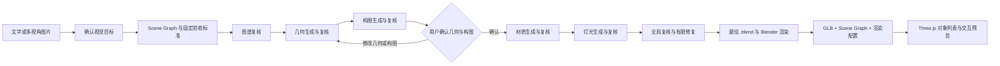

# 场景生成、Scene Graph 与 Three.js 预览方案

## 结论与适用范围

本方案借鉴 `Agen3D/canova_code_server` 的分阶段生成与复核机制，形成适用于文字生成、参考图重建和已有场景修改的通用流程。对于需要完整重建的任务，建议按“确认视觉目标 → Scene Graph → 几何 → 构图确认 → 材质 → 灯光 → 全局复核 → 导出与预览”执行；具体阶段和轮数由任务计划配置。生成期间，`.blend` 是可编辑场景的权威状态；Blender 渲染图是视觉验收依据；GLB、渲染配置和 Three.js 预览用于交互检查与交付。

当前 `UniBlenderScene` 已有独立 Blender bridge、`SceneStore`、编辑前检查点、最佳候选、Blender 渲染、GLB 导出和渐进式 Three.js 预览。新增工作的重点是分阶段计划与确认、结构化复核，以及让初始化时建立的 Scene Graph 在预览中成为可操作的对象列表。保留现有 host-driven 架构：宿主模型负责规划、生成代码和视觉判断，MCP 服务负责场景状态、执行顺序、检查点、导出与数据校验。参见 [`src/service/store.ts`](../src/service/store.ts)、[`skills/blender-scene/SKILL.md`](../skills/blender-scene/SKILL.md) 和 [`src/viewer/widget.ts`](../src/viewer/widget.ts)。

下文“参考项目”表示本机 `Agen3D/canova_code_server` 中已存在的行为；“本插件要求”表示本仓库的目标行为。参考项目位于另一个仓库，其路径仅用于定位代码，不是本插件的依赖。Scene Graph、节点列表和对象框选是跨生成策略的能力，不绑定某一种算法。

**首版实施状态（2026-11-08，后续约束更新见 [0.2.0 验收](acceptance-0.2.0.md)）：** 已接入图谱与阶段计划、每阶段预算和结构化复核、构图暂停与五张中性视图、显式确认／退回、GLB 稳定 ID 映射和导出校验、图谱列表与对象／父组框选。0.2.0 已加入基础几何、对象矩阵与相机、材质节点和灯光设置的阶段签名校验；它不覆盖任意脚本、完整节点组求值、外部纹理像素或所有 Blender 数据块，也不自动判断参考图空间语义。视觉合格仍以 Blender 渲染及人工判断为准。详见 [验证记录](validation.md)。

## 1. 输入与 Scene Graph

### 视觉目标

有参考图时，保留一张主视角和最多五张辅助视角；主视角确定相机与构图，辅助视角帮助判断深度、遮挡和对象关系。纯文字请求可以先形成待用户确认的概念图；确认后再开始较长的场景建设。概念图生成属于可选的宿主能力，不作为 Blender MCP 服务内置的模型或 Provider。当前插件已经支持最多六张同场景参考图，但没有内置概念图确认流程。参见 [`README.md`](../README.md) 和 [`src/service/store.ts`](../src/service/store.ts)。

### 图谱数据格式

新场景初始化时由宿主生成 Scene Graph，再冻结本次请求的验收标准。修改已有场景时，宿主先读取实际 Blender 对象，并与本次修改范围核对后建立或更新图谱。每个节点至少包含以下信息：

| 字段 | 用途 |
| --- | --- |
| `id` | 场景内稳定且唯一的节点 ID；重命名对象后仍保持不变。 |
| `label` | 列表中显示的名称。 |
| `kind` | `group`、`object` 或 `part`。 |
| `parentId` | 父节点 ID；根节点为 `null`。 |
| `blenderObjectNames` | 直接属于该节点的 Blender 对象名；纯组织节点可为空。一个节点可对应多个 Blender 对象。 |
| `description` | 对象、部件或分组的识别特征。 |
| `relations` | 另存为节点之间的空间或语义关系，并引用稳定 ID。 |

图谱必须检查 ID 与对象名引用、父节点存在性、层级环、关系端点及首轮骨架覆盖。重要主体、身份明显的小物件和需要单独检查的部件应有节点。对象是否已经建成是运行状态，不因它出现在计划图谱里就视为已完成。参考项目的类型和检查位于 `canova_code_server/src/host-tools/workflow-memory.ts`；本插件应把相应的数据和状态存入 `SceneStore`，放在 `.canova/runs/<scene-id>/` 下。

### 图谱与模型的一致性

宿主在创建或细化对象时，应给直接对应的 Blender 对象写入稳定节点 ID，例如对象自定义属性 `scene_node_id`。纯组织节点不必制造空网格。`blenderObjectNames` 方便人在 Blender 中定位对象，导出与预览匹配应优先使用稳定 ID，避免改名、同名后缀、材质拆分或 Blender 到 glTF 的坐标转换导致错选。

导出时启用 glTF `extras` 并保留对象上的稳定 ID，同时生成与该次最佳 `.blend` 和 `final.glb` 同版本的 `scene-graph.json`。它记录节点层级、直接对象映射、可渲染状态和导出迭代号。导出校验需确认每个标记为已建成且可渲染的节点能在 GLB 中找到对应网格；未建成、隐藏或不支持导出的节点应有明确状态，不能静默映射到近似名称。一个节点对应多个网格时，预览取这些网格的并集。

## 2. 分阶段生成与复核

参考项目将同阶段的对象任务合成一个阶段任务，共享轮数。完整重建任务可采用下表的阶段配置：阶段验收检查当前因子，最终复核再检查全部因子。阶段顺序、是否需要人工确认及轮数应按任务类型配置；已有场景的局部修改可以只执行受影响阶段，但仍需检查相关回归。预算属于场景请求，而非单个对象：

| 阶段 | 参考轮数上限 | 本阶段可改动 | 复核重点 |
| --- | ---: | --- | --- |
| 几何 | 5 | 对象、部件和形状 | 图谱覆盖、轮廓、比例、结构。首轮建立可辨认的完整骨架。 |
| 构图 | 3 | 对象变换与相机 | 主视角画幅、位置、朝向、深度与遮挡。 |
| 材质 | 3 | 材质、贴图、UV 和表面参数 | 表面颜色、纹理、粗糙度和法线；保留已确认的几何与相机。 |
| 灯光 | 2 | 灯光、世界光、曝光和显示 Look | 明暗、投影、反射与高光；保留几何、对象位置、相机和材质。 |

每轮遵循固定状态转换：`checkpoint → edit → render → inspect → review → decide`。MCP 服务拒绝乱序调用。宿主一次提交有限的 Blender 修改，服务在独立 bridge 中保存与渲染；复核提交每条固定标准的通过状态、图谱节点 ID、参考视角、目标观察、当前观察、场景证据、未通过原因、具体修正和下一次渲染可执行的验收方法。修正列表最多三项，按视觉影响排序。服务记录每轮结果并选择历史最佳候选；连续两轮无改善或阶段预算结束时，恢复该阶段的最佳场景。参考项目的实现位于 `canova_code_server/src/task-runtime.ts` 与 `canova_code_server/src/host-tools/workflow-memory.ts`。

0.2.0 在场景编辑事务内比较基础因子签名，材质阶段改变对象矩阵或相机会报错并回滚，灯光阶段改变材质节点也会回滚。签名覆盖的范围有限，不代表完整 Blender 状态或最终外观等价。

### 构图确认

完整重建任务必须包含构图确认。构图阶段结束后从阶段最佳 `.blend` 生成主相机、正面、侧面、俯视和透视五张中性材质视图，保存确认检查点，将场景置为 `awaiting_review`，并释放执行槽。用户可以：

- 确认几何与构图，直接从检查点进入材质阶段；
- 提交明确修改要求，退回构图或几何。退回几何后仍需完成构图并再次确认。

等待确认期间不开始材质、灯光或最终 GLB 导出。重启后保留图谱、固定标准、检查点和待确认状态。最终修复不能自动修改用户已确认的几何与构图；相关未通过项要如实列入剩余差距。参考项目的实现位于 `canova_code_server/src/task-runtime.ts` 中的 `renderReviewViews`、`pauseForReview` 和 `review`。

需要交互检查时，在 `awaiting_review` 调用 `scene_preview`，再通过 `scene_view` 查看进度和结果。服务从最佳检查点生成配套 GLB、渲染配置、Scene Graph 和 manifest，保存于 `previews/<iteration>/`。预览不批准构图、不推进阶段或消耗编辑轮数，也不修改最佳 `.blend` 和渲染图；最终 `scene_export` 仍受完成状态限制。

### 明确追加的有限返修

`scene_revise` 用于用户明确授权的几何／构图局部返修。宿主先读取实时
`scene_view`，绑定 phase、status、iteration、updatedAt 与唯一 requestId，
再提交节点范围、反馈和额外 1–8 轮。服务归档既有状态与检查点，将新增消耗
与原阶段预算分开记录，不清空历史、不退款式回退轮数、不重开场景。未知旧账
标为未知，不推测可用额度；重复请求不会再次追加。拒绝结构本身不补满预算。

返修保护范围外几何、摆放、主相机／画幅、既有材质图与灯光；共享网格改动
影响无关对象时回滚。允许更新范围内对象映射，不改变冻结图谱语义。
灰模预览记录 revisionId 和实际内容版本，保存于该返修的独立目录，避免覆盖
旧阶段预览。返修停止后以选定内容生成新的只读构图检查，不赠送构图编辑轮次；
仍需真实构图审查与用户明确批准。返修授权不是付费资产生成或外部上传授权。

### 完整场景复核

最终复核检查本次任务的全部标准和相关回归。参考项目为完整重建预留两轮全局修复；本插件可按任务复杂度配置，但修复应沿用同一个全局最佳候选和预算，不重开阶段以取得额外轮数。复核保留实际 Blender 状态、渲染图和必要的对应区域颜色／明暗数据；区域测量辅助判断材质、灯光或曝光问题，不自动代表视觉通过。结果区分 `completed` 与带剩余差距的 `best_effort`。

## 3. 导出与 Three.js 预览

### 交付文件及职责

| 文件 | 职责 |
| --- | --- |
| `final.blend` 或现有的最佳 `.blend` | 可继续编辑的权威场景。 |
| `final.png` 或现有的最佳渲染图 | Blender 视觉验收与预览中的静态图。 |
| `final.glb` | 浏览器使用的几何、PBR 材质、相机和基础灯光载荷。 |
| `render-profile.json` | Blender 的相机投影、灯光、世界、渲染与显示变换配置。 |
| `environment.exr` | 存在环境贴图或程序化天空时提供线性环境辐射。 |
| `scene-graph.json` | 与该次 GLB 配对的节点层级、稳定 ID、映射和完成状态。 |
| `manifest.json` | 文件、迭代、结果、剩余差距与版本对应关系。 |

沿用当前 [`runtime/blender/export.py`](../runtime/blender/export.py) 的独立副本导出、PBR 纹理烘焙、相机／灯光／环境与显示 LUT，沿用 [`src/viewer/widget.ts`](../src/viewer/widget.ts) 的 GLB 加载、渐进路径追踪、OrbitControls、降噪和静态图切换。补充导出一致性检查：可见对象与图谱映射、相机矩阵与投影、灯光类型和有效能量，以及 `scene-graph.json`、GLB 和 manifest 的迭代号必须一致。导出不应修改权威 `.blend`。

Three.js 预览仍是交互检查工具。复杂 Blender Shader、体积效果和 Cycles 专用节点不一定能由 glTF 或浏览器路径追踪等价表达；需要时烘焙可映射的表面通道，并在交付中说明残余差异。不要用浏览器画面代替 Blender 渲染判定场景已达到视觉标准。参考项目的转换与校验位于 `canova_code_server/scripts/export-preview-materials.py` 和 `canova_code_server/scripts/validate-preview-glb.py`。

### Scene Graph 列表与对象框选

Three.js 预览增加一个与 GLB 同版本的 Scene Graph 列表。列表按 `parentId` 展示缩进层级；父节点可以展开和收起，展开状态与选中状态分开保存。每行显示名称、节点类型和必要的生成状态。列表可在图谱创建后显示，但只有对应 GLB 已载入并完成映射的节点可执行 3D 框选；场景仍在制作时，点击节点显示其计划信息和当前状态。

点击节点后的行为：

1. 用 `id` 查找 GLB 中的直接映射对象。选中父节点时，递归包含所有子孙节点的可渲染网格；父节点本身有网格时也一并包含。折叠列表不改变父节点的选择范围。
2. 对选中网格的世界空间边界求并集，忽略相机、灯光和预览辅助对象。纯组织父节点依靠子孙网格得到边界；没有任何可见网格时说明“此节点暂无可预览对象”，不跳到其他对象。
3. 在 Three.js 画布上绘制清晰的选中框，并显示节点名称。选中框属于独立覆盖层，不写入 GLB，不参与路径追踪的光照、阴影或反射；转动或缩放相机时同步更新。再次选中其他节点时只保留一个选中框。
4. 将 OrbitControls 的目标移动到边界中心，并按透视／正交相机的实际投影与画幅计算合适距离或缩放，留出边距，完整容纳所选范围。相机朝向尽量保持当前观察方向；点击现有“重置相机”恢复导出场景的初始视角和目标。
5. 从静态 Blender 图切到 3D 模式后执行框选。静态图不伪造对象位置；若 GLB 加载失败，列表仍可阅读，并提供明确的预览失败状态。

选择框可以用投影后的屏幕空间覆盖层实现，避免修改材质或把辅助几何加入路径追踪场景。对跨越近裁剪面或完全位于镜头外的边界，要正确裁剪或暂时隐藏覆盖层；相机聚焦后再重新计算。选择和取消选择不应触发 Blender 编辑、重新导出或修改模型材质。列表支持键盘聚焦、展开／收起和选中状态说明；窄屏时允许收起面板，避免遮挡主要预览画面。

必须处理以下映射情形：

- 一个图谱节点对应多个 GLB 网格时，框选所有直接网格。
- 纯组织父节点没有直接网格时，框选所有可见子孙网格的并集。
- 子节点缺失、隐藏或未导出时，父节点仍框选其余有效子孙，并标出未映射项；不使用名称模糊匹配猜测对象。
- 场景细化后重新导出时，清除旧 GLB 的对象索引与选中框，以新 `scene-graph.json` 重建；若稳定 ID 仍存在，可恢复用户的选中节点。

## 4. 对当前插件的实施顺序

1. **场景数据和状态**：在 `SceneStore` 中保存 Scene Graph、阶段标准、阶段预算、最佳候选及确认状态；扩充 `scene_plan`、`scene_review` 或增设明确的阶段工具，拒绝乱序操作。保持现有 bridge 和单场景写入队列。
2. **用户确认**：在 `scene_view` 快照和 widget 中显示阶段进度、五张确认视图及确认／修改操作；确认后从同一个检查点恢复。此处需要明确的宿主工具调用，不允许普通“继续修改”绕过确认。
3. **图谱导出映射**：给 Blender 对象保存稳定 ID，在 GLB 中保留并验证映射，输出与最佳场景同版本的 `scene-graph.json`。扩充 `scene_asset_chunk` 允许 widget 读取该文件。
4. **预览交互**：在现有 widget 中增加层级列表、父节点子树选择、可见网格边界框、相机聚焦、重置和重新导出后的状态同步。保留现有静态图／3D 切换与资源释放逻辑。
5. **诊断和导出验收**：增加阶段专用 Blender 状态检查、必要的局部外观测量，以及场景、GLB、图谱、相机、灯光之间的一致性检查。

## 5. 验收条件

- 计划图谱中 ID 唯一、父子关系无环、对象引用有效；首轮骨架覆盖所有计划中的主要主体。阶段轮数不能因拆分对象任务增加。
- 采用构图确认的任务在构图完成后确实暂停；用户确认前不执行后续阶段和最终导出。重启后仍能从同一确认检查点继续。
- 每轮复核覆盖本阶段全部固定标准，并引用真实图谱 ID 与渲染／Blender 状态；回归时能恢复最佳 `.blend`。
- 最终交付的 `.blend`、渲染图、GLB、`scene-graph.json` 和配置来自同一个最佳迭代；缺失或错误映射会阻止宣称导出成功。
- 列表点击单个对象能看到对应选中框并聚焦；点击纯组织父节点能框住所有可见子孙；隐藏或缺失对象有明确状态；转动视角时框随画面更新；重置相机回到初始视角。
- 重新导出并加载同一场景后，旧对象索引与辅助覆盖层被释放，稳定 ID 仍存在的选中节点能重新定位。静态图模式不继续进行路径追踪采样。
- 用真实 Blender 场景与浏览器 widget 分别验证单对象、多网格对象、空父节点、多层父节点、隐藏子节点、改名、重新导出、透视相机及正交相机；记录 Blender 渲染与浏览器画面的实际差异，不宣称逐像素一致。

0.2.0 已补基础阶段签名和构图审批强制校验；局部外观测量、完整数据块冻结及更广的正交／隐藏对象浏览器场景验证仍待补充。
