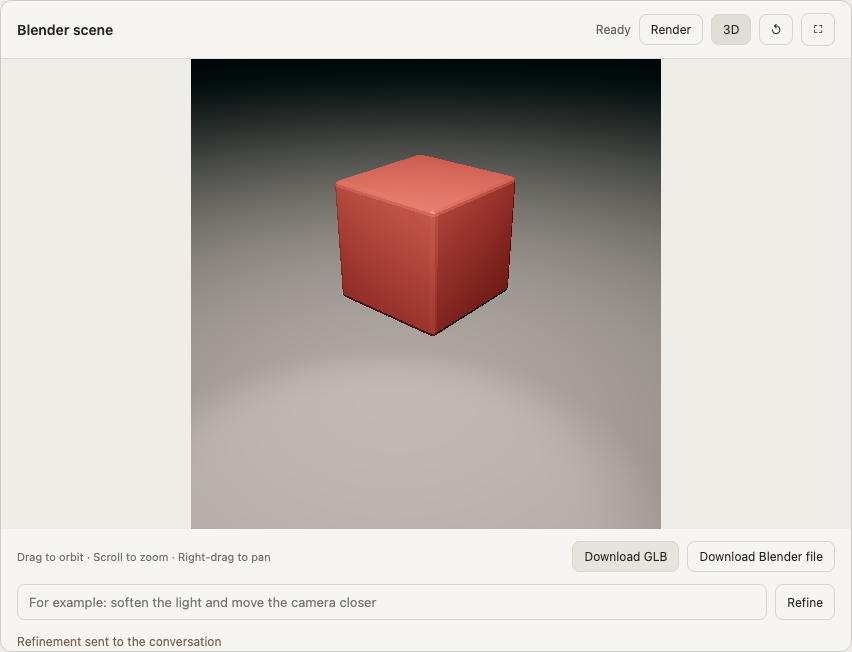

# Validation — 0.1.0

Checked on 2026-11-04 with Node.js 22.20.0, Blender 5.1.1, and Chromium
148.0.7778.96 on macOS. The service used a separate Blender process, HTTP port,
and temporary `.canova/runs` directory.

| Check | Result | Evidence |
| --- | --- | --- |
| TypeScript | Passed | `npm run check` |
| Self-contained viewer build | Passed | `npm run build` |
| Workflow checks | 5 passed | `npm test` |
| Portable manifests | Passed | Draft 2020-12 validation against the canonical `plugin.json` and `mcp.json` schemas |
| Dependency advisories | 0 reported | `npm audit --registry=https://registry.npmjs.org` |
| Real Blender workflow | Passed | `npm run test:blender` |
| MCP Apps iframe viewer | Passed | `npm run test:viewer -- <evidenceDirectory>` |
| Clean ZIP extraction | Passed | Fresh `npm ci`, type check, build, and all 5 workflow checks in a separate directory |
| Archive exclusions | Passed | 35 entries; no `.git`, `.canova`, `node_modules`, or `.env` included |

The Blender check exercised HTTP MCP initialization, all eight tool
registrations, resource reading, scene creation, frozen planning, Python edits,
PNG rendering, review recording, best-checkpoint GLB export, and scene viewing.
It polled jobs through image-free `scene_view` responses and queried one named
Blender object for its rotation mode, world matrix, materials, and polygon count.
It rejected stale reviews and unauthorized artifact reads, transferred a PNG
through an explicitly approved HTTPS reference host, continued a scene with a
new request, and recovered from an intentionally failed edit. A subsequent
Blender edit asserted that the original object existed and the failed mutation
had been removed.

The example generated a 266,997-byte PNG and a 16,300-byte GLB. Its render showed
a red beveled cube on a lit floor. The integration script supplied review values
to test the protocol; it did not run an autonomous model or measure visual
similarity. The rendered image and interactive preview were separately inspected.

The viewer check used the official MCP AppBridge in a sandboxed iframe with
`allow-scripts`, `allow-same-origin`, and `allow-downloads`, without form
submission permission. CSP restricted assets to the test origin. It verified
the handshake, GLB loading, automatic color calibration, orbit dragging, camera
reset, render/3D switching, refinement messages, expansion requests, and GLB
download. It recorded no JavaScript page errors.

The image shows the bundled viewer with the integration scene. WebGL lighting
approximates Blender; this check does not establish pixel equivalence.

## Scope

The package adapts the scene workflow for a host-supplied model. It does not
include the original ModelHub integration, Codex App Server runtime, evaluation
runner, application session UI, or historical scene data.

These checks do not establish HTTPS deployment, installation in a live ChatGPT
account, ChatGPT-native image upload, automatic Skill selection, subagent
registration, OAuth, public-directory approval, multi-user isolation, or
performance on large production scenes. Read the
[service setup](operations.md) before connecting a client.

The [portable manifest](https://agent-plugins.org/schemas/1.0.0/plugin.schema.json)
and [MCP configuration](https://agent-plugins.org/schemas/1.0.0/mcp.schema.json)
were checked against their canonical schemas.

The plugin's ZIP includes the built viewer and excludes dependencies,
credentials and runtime data. GitHub publication distributes source; it does
not deploy the MCP service or start Blender.
